<div align="center">

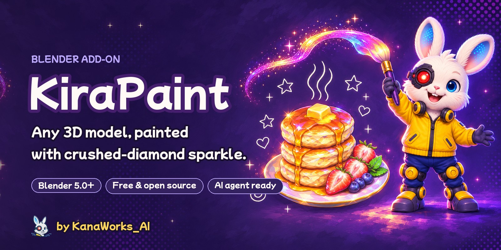

<p>
  <a href="https://github.com/kanaworksai-hue/kirapaint/releases/latest"></a>
  
  
  
  
  <a href="LICENSE"></a>
  <a href="https://github.com/kanaworksai-hue/kirapaint/stargazers"></a>
</p>

<p><a href="https://github.com/kanaworksai-hue">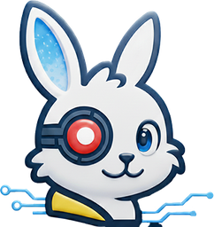</a>&nbsp;<a href="https://github.com/kanaworksai-hue"><b>A KanaWorks_AI project</b></a>&nbsp;·&nbsp;<a href="#-kanaworks-add-ons">More add-ons</a></p>

[日本語](README.md) | **English** | [简体中文](README.zh-CN.md)

[🎨 Gallery](#-gallery) · [🚀 Get started](#-get-started) · [🎛️ What you can tweak](#️-what-you-can-tweak) · [❓ FAQ](#-faq) · [⭐ Star it](#-star-it)

</div>

**KiraPaint** is a free Blender add-on that turns 3D models into a sparkly, painterly 2.5D look. It breaks the surface into small glossy facets, lets them reflect pink, cyan, violet and gold light, paints over the image with brush strokes, and puts star glints on the brightest spots — like crushed diamonds in a hand-painted picture.

It works on **any model**: downloaded, scanned or AI-generated. It never replaces your materials — it slips in front of them and remembers what was there, so you can always go back. You can also ask an AI agent to install and apply it in one sentence.

<p align="center">
  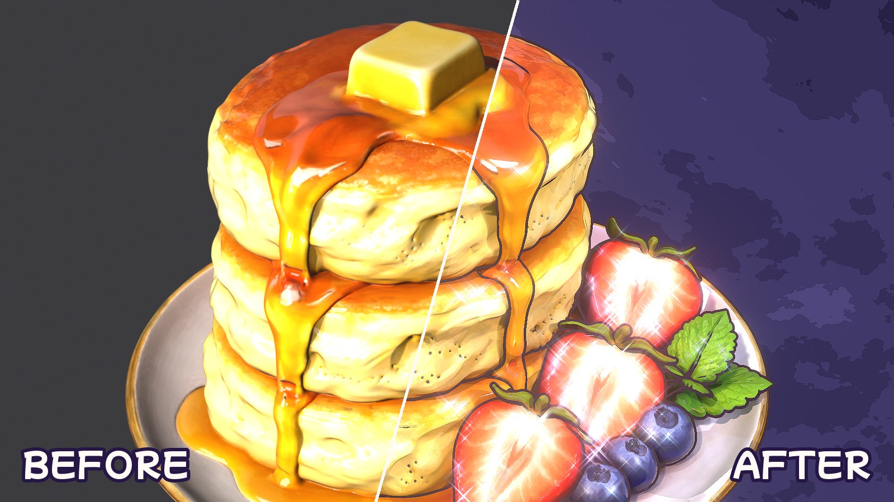
  <br><sub>Same model, same camera. Left: a normal render. Right: KiraPaint.</sub>
</p>

## ✨ Features

<table>
<tr>
<td align="center" width="25%">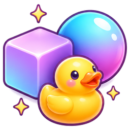<br><b>Any model</b><br><sub>glTF, FBX, OBJ, .blend — anything with a Principled BSDF</sub></td>
<td align="center" width="25%">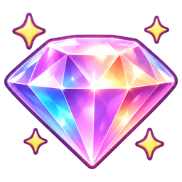<br><b>Crushed-diamond sparkle</b><br><sub>Glossy facets catch colored light, then twinkle with star glints</sub></td>
<td align="center" width="25%">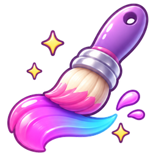<br><b>Brush strokes</b><br><sub>Brush size follows your render resolution automatically</sub></td>
<td align="center" width="25%"><br><b>Ask your AI</b><br><sub>One sentence to your agent: install, apply and preview</sub></td>
</tr>
</table>

- **Fully reversible:** your materials are never replaced. **Remove** puts materials, world and compositor back.
- **Sizes itself:** facet size and outline width follow the model's size; brush size follows the render resolution.
- **Realistic ↔ 2.5D on one slider:** keyframe **2.5D** and you get the "photo turns into a painting" reveal for free.
- **10 backgrounds:** Night Purple, Starry Sky, Sakura Pink, Strawberry Polka, Mint Soda, Sky Soda, Lemon Cream, Peach Dream, Magic Sunset and Soft Studio. Click a thumbnail in the panel to switch; the doodles recolor to match.
- **One-click scene:** EEVEE, a light rig (key, rims and five colored specular-only glint lights), the backdrop and the compositor.
- **Chalk doodles:** stars, hearts, swirls and twinkles placed around the model, never on it. Steam for food.

## 🎨 Gallery

### Still 3D: turn it around

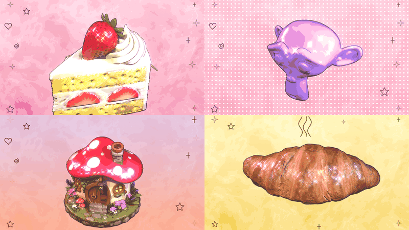

### Any model

The author's own models, CC0 models and Blender's own monkey. One click each, same settings; only the background changes.

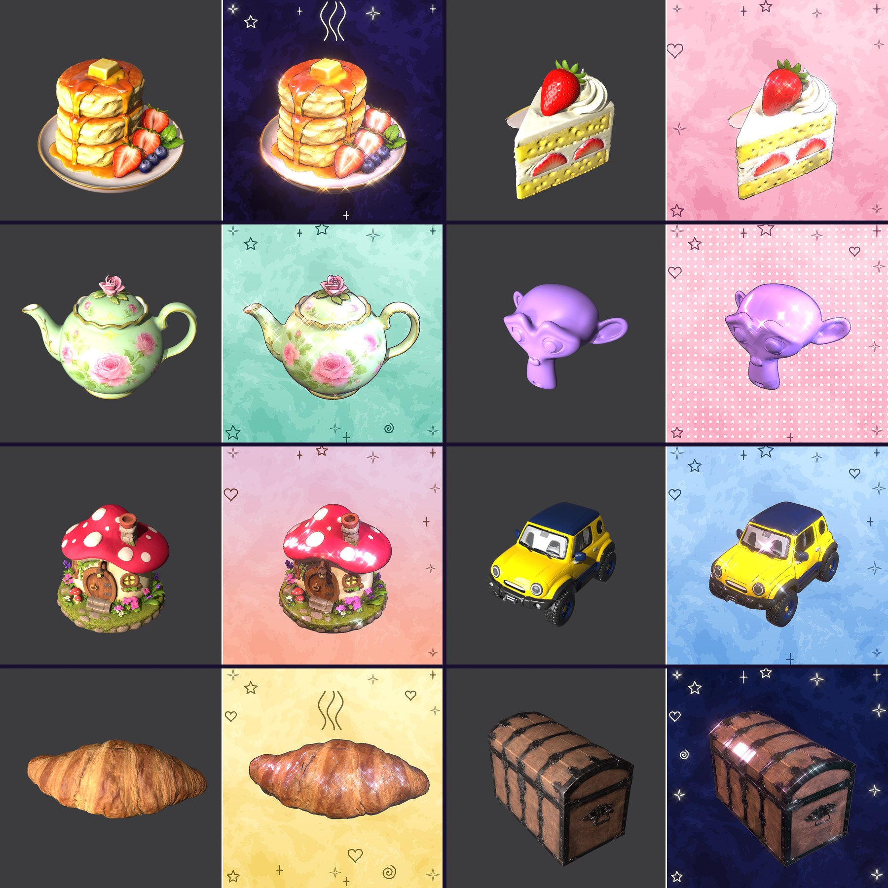

### 10 backgrounds

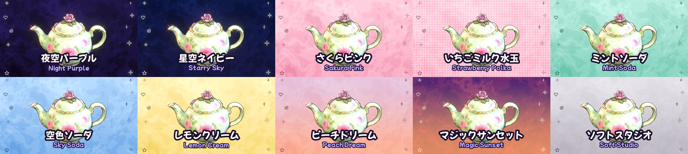

### Layers

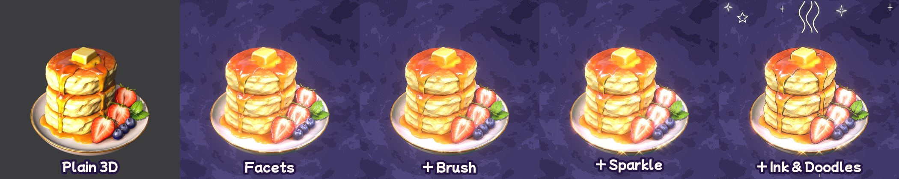

### Four presets

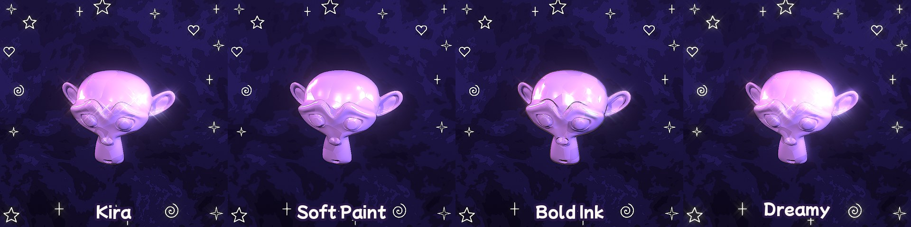

## 🧭 How it works

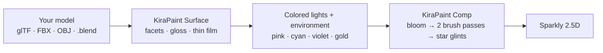

1. **KiraPaint Surface** (shader) goes in front of every Principled BSDF. It tilts the normal per Voronoi cell so the surface breaks into flat little facets, raises the gloss and adds a thin-film rainbow.
2. Each facet faces a different way, so each one reflects a different **colored light or patch of environment**. That is the crushed-diamond look.
3. **KiraPaint Comp** (compositor) repaints the image: bloom → sharpen → two anisotropic Kuwahara passes → sharpen → mix, then four-point star glare on the brightest facets.

## 🚀 Get started

### Ask your AI agent (recommended)

Send this to an AI agent that can use your computer, such as Claude Code or Codex:

> Follow the AGENTS.md at https://github.com/kanaworksai-hue/kirapaint to install KiraPaint and make my model sparkly and painterly.

Then fix things in plain words while looking at the preview:

- "More sparkle"
- "Bigger brush strokes"
- "Stronger rainbow sheen"
- "Use the Mint Soda background"
- "No doodles"
- "Add a reveal from realistic to painted, and turn it 60 degrees"

### Install it yourself

**You need:** Blender 5.0 or newer (tested on 5.1 and 5.2) and the EEVEE render engine.

1. Download `kirapaint-x.y.z.zip` from [Releases](https://github.com/kanaworksai-hue/kirapaint/releases/latest)
2. Blender → Edit → Preferences → Get Extensions → ▾ (top right) → **Install from Disk…** → pick the zip
3. In the 3D view press **N** → **KiraPaint** tab

### Use it

1. Select your model (nothing selected = every mesh in the scene)
2. Pick a style (preset) and a background
3. **Make It Kira**
4. Slide **2.5D** between realistic and painted, fine-tune under **Look**
5. Render with F12 (the brush strokes come from the compositor, so they show in the render)

<p align="center">
  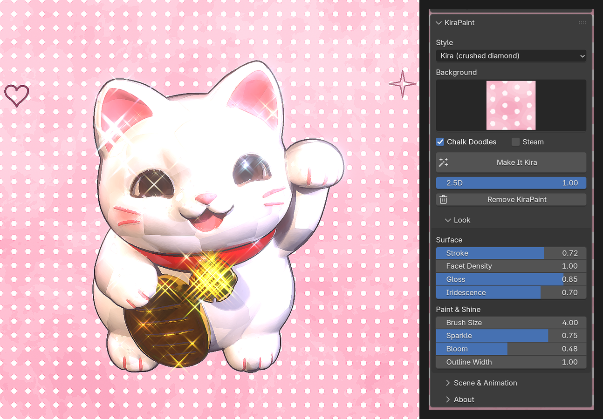
</p>

## 🎛️ What you can tweak

<details>
<summary><b>The Look panel</b></summary>

| Setting | What it does |
|---|---|
| 2.5D | 0 = normal render, 1 = KiraPaint. Keyframe it |
| Stroke | How strongly the surface breaks into facets (normal distortion) |
| Facet Density | Facet size; 1 = about 6 across the model |
| Gloss | How glassy the facets get (pulls roughness toward 0.06) |
| Iridescence | Pink / cyan thin-film rainbow |
| Brush Size | Brush size in pixels at 1080p, scaled to your resolution |
| Sparkle | Star glint strength and the glint lights' brightness |
| Bloom | Soft glow |
| Outline Width | Outline thickness, relative to the model's size. 0 = none |
| Background | One of 10 backdrops (pick a thumbnail) or Keep Mine (your world) |
| Chalk Doodles / Steam | Doodles and steam lines |

</details>

<details>
<summary><b>Presets</b></summary>

| Preset | Feel |
|---|---|
| **Kira** (default) | Glossy facets, colored glints, star sparkles: crushed diamond |
| **Soft Paint** | Gentle oil paint, few sparkles |
| **Bold Ink** | Thick outline, crisp strokes |
| **Dreamy** | Strong rainbow and glow |
</details>

<details>
<summary><b>Animation</b></summary>

In the **Scene & Animation** panel:

- **Add Reveal:** keyframes 2.5D from 0 to 1 from the current frame — realistic turns into painted.
- **Add Turntable:** parents the model to an empty at its center and turns it. Lights and camera stay put, so the glints slide across the facets.
- **Re-aim Lights / Redraw Doodles:** after moving the camera.
</details>

## ❓ FAQ

<details>
<summary><b>Does it work in Cycles?</b></summary>

The material part does, but the brush strokes and star glints come from the compositor and the look is tuned for EEVEE. **Make It Kira** switches to EEVEE.
</details>

<details>
<summary><b>I don't see the brush strokes in the viewport.</b></summary>

They are added by the compositor, so they show in F12 renders. To see them in the viewport, set the viewport shading's Compositor option to "Always".
</details>

<details>
<summary><b>It looks washed out.</b></summary>

Cream and white models catch a lot of light. Lower **Sparkle** and **Gloss** a little. Dark models (bronze, wood, pumpkins) look great with **Iridescence** turned up.
</details>

<details>
<summary><b>What happens to my materials?</b></summary>

Nothing is replaced. A "KiraPaint Surface" node is inserted in front of each Principled BSDF, and the original links and values are remembered. **Remove KiraPaint** restores them. Materials without a Principled BSDF (MochiToon toon materials, emission-only materials) are skipped and reported.
</details>

<details>
<summary><b>Can I use my renders commercially?</b></summary>

Yes. Images and videos you make with KiraPaint are your own work. The GPL covers the add-on's code, not what you make with it (follow the licenses of the models and textures you use).
</details>

## ⭐ Star it

If you like KiraPaint, a **⭐ Star** on the [repository page](https://github.com/kanaworksai-hue/kirapaint) (top right) helps a lot. It's free and takes a second.

Showing your renders on X with [@KanaWorks_AI](https://x.com/KanaWorks_AI) and **#KanaWorksBlender**, or telling us about bugs and wishes in [Issues](https://github.com/kanaworksai-hue/kirapaint/issues), keeps the updates coming.

## 🧩 KanaWorks add-ons

Free, open-source Blender add-ons by the same author. Each one can be driven by an AI agent with one sentence.

<table>
<tr>
<td align="center" width="50%"><a href="https://github.com/kanaworksai-hue/mochitoon"></a><br><b><a href="https://github.com/kanaworksai-hue/mochitoon">MochiToon</a></b><br><sub>Cute manga toon shading: colored shadows, heart and star halftones, outlines</sub></td>
<td align="center" width="50%"><a href="https://github.com/kanaworksai-hue/kirapaint">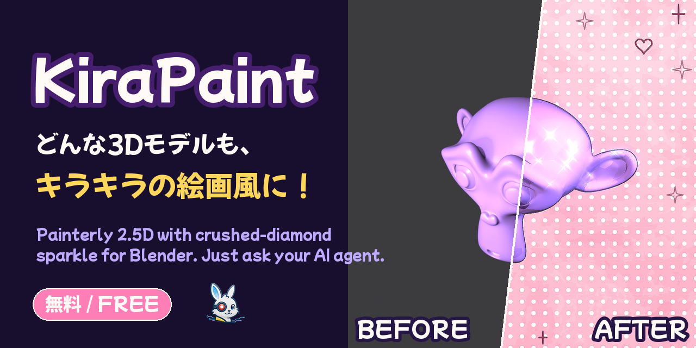</a><br><b>KiraPaint</b> (this page)<br><sub>Sparkly painterly 2.5D: crushed-diamond gloss, brush strokes, star glints</sub></td>
</tr>
</table>

## 🛠️ Development

```bash
# smoke test
blender -b --factory-startup --python tests/test_ops.py

# before / after of any model
blender -b --factory-startup --python tests/render_demo.py -- model.glb tests/out/demo KIRA 1080 1350

# build the release zip into dist/
blender --factory-startup --command extension build --source-dir kirapaint --output-dir dist
```

```
kirapaint/
  nodes.py     "KiraPaint Surface" shader and "KiraPaint Comp" compositor node groups
  core.py      material insert / restore, outline, lights, world, compositor, animation
  doodles.py   chalk doodles (Grease Pencil)
  api.py       make_kira(): one-call entry point for agents and scripts
  ops.py, ui.py  settings, operators, panels
  presets.py   the four presets
agent/kirapaint_agent.py  command line for AI agents
```

## 📄 License and credits

- **This add-on:** Copyright © 2026 Tokyo AI Visuals LLC (東京AI映像合同会社). Released under [GPL-3.0-or-later](LICENSE).
- **Brand:** the KanaWorks_AI name, logo and the character Kana belong to Tokyo AI Visuals LLC and are **not** covered by the GPL. See [docs/brand](docs/brand/README.md).
- **Sample models:** the author's own models, CC0 models, and Blender's Suzanne.
- **Technique:** painterly rendering with Kuwahara filters and noise-distorted normals is a technique widely shared in the Blender community.
- **Blender** is a trademark of the Blender Foundation. This is an independent project, not affiliated with or endorsed by the Blender Foundation.

<br>

<div align="center">

<a href="https://x.com/KanaWorks_AI"></a>

<p><b>Made with ♥ by <a href="https://x.com/KanaWorks_AI">KanaWorks_AI</a></b></p>

<p><sub>If KiraPaint helps you, a ⭐ keeps the updates coming. More projects: <a href="https://github.com/kanaworksai-hue">github.com/kanaworksai-hue</a></sub></p>

</div>
