<div align="center">

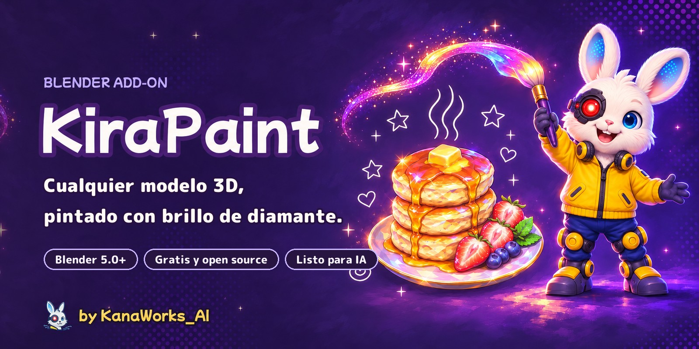

<p>
  <a href="https://github.com/kanaworksai-hue/kirapaint/releases/latest"></a>
  
  
  
  
  <a href="LICENSE"></a>
  <a href="NOTICE.md"></a>
  <a href="https://github.com/kanaworksai-hue/kirapaint/stargazers"></a>
</p>

<p><a href="https://github.com/kanaworksai-hue"></a>&nbsp;<a href="https://github.com/kanaworksai-hue"><b>Un proyecto de KanaWorks_AI</b></a>&nbsp;·&nbsp;<a href="#-add-ons-de-kanaworks">Más add-ons</a></p>

[日本語](README.md) | [English](README.en.md) | [简体中文](README.zh-CN.md) | [한국어](README.ko.md) | [Português](README.pt-BR.md) | **Español**

[🎨 Galería](#-galería) · [🚀 Primeros pasos](#-primeros-pasos) · [🎛️ Qué puedes ajustar](#️-qué-puedes-ajustar) · [❓ Preguntas frecuentes](#-preguntas-frecuentes) · [⭐ Dale una estrella](#-apóyalo-con-una-estrella)

</div>

**KiraPaint** es un add-on gratuito para Blender que convierte tus modelos 3D en un 2.5D pictórico lleno de brillo. Divide la superficie en pequeñas facetas brillantes que reflejan luz rosa, cian, violeta y dorada, repinta la imagen con pinceladas y añade destellos de estrella en los puntos más luminosos: como diamante triturado sobre un cuadro pintado a mano.

Funciona con **cualquier modelo**: descargado, escaneado o generado con IA. Nunca sustituye tus materiales: se coloca delante de ellos y recuerda lo que había, así que siempre puedes volver atrás. También puedes pedirle a un agente de IA que lo instale y lo aplique por ti con una sola frase.

<p align="center">
  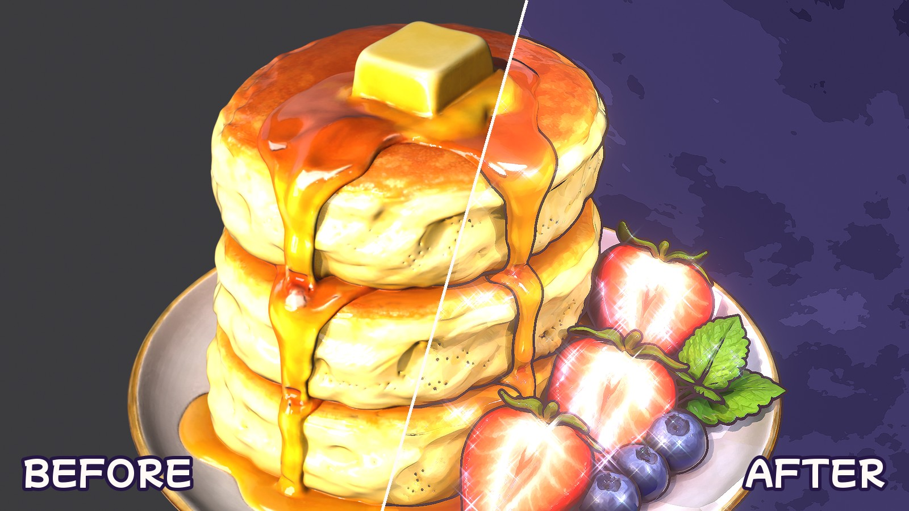
  <br><sub>Mismo modelo, misma cámara. Izquierda: un render normal. Derecha: KiraPaint.</sub>
</p>

## ✨ Características

<table>
<tr>
<td align="center" width="25%">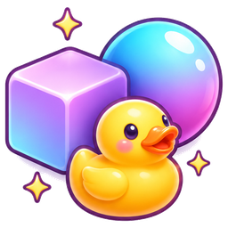<br><b>Cualquier modelo</b><br><sub>glTF, FBX, OBJ, .blend: todo lo que use un Principled BSDF</sub></td>
<td align="center" width="25%">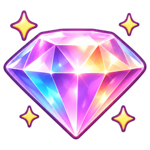<br><b>Brillo de diamante triturado</b><br><sub>Las facetas brillantes atrapan luz de colores y centellean con destellos de estrella</sub></td>
<td align="center" width="25%">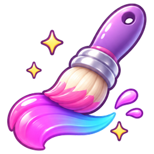<br><b>Pinceladas</b><br><sub>El tamaño del pincel se adapta solo a la resolución de tu render</sub></td>
<td align="center" width="25%">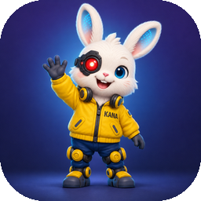<br><b>Pídeselo a tu IA</b><br><sub>Una frase a tu agente: instalación, aplicación y vista previa</sub></td>
</tr>
</table>

- **Totalmente reversible:** tus materiales nunca se sustituyen. **Remove** restaura los materiales, el World y el compositor.
- **Se ajusta solo:** el tamaño de las facetas y el grosor del contorno siguen el tamaño del modelo; el tamaño del pincel sigue la resolución del render.
- **De realista a 2.5D con un solo deslizador:** pon keyframes en **2.5D** y tendrás gratis el efecto de "la foto se convierte en cuadro".
- **Interfaz en japonés:** con Blender en japonés, KiraPaint cambia a japonés solo. En un Blender en inglés, elige 日本語 en el menú 🌐 de la esquina superior derecha del panel para ver solo el panel en japonés.
- **10 fondos:** Night Purple, Starry Sky, Sakura Pink, Strawberry Polka, Mint Soda, Sky Soda, Lemon Cream, Peach Dream, Magic Sunset y Soft Studio. Haz clic en una miniatura del panel para cambiarlo; los dibujitos cambian de color a juego.
- **Escena con un clic:** EEVEE, un juego de luces (principal, contraluces y cinco luces de color solo especulares para los destellos), el fondo y el compositor.
- **Dibujitos de tiza:** estrellas, corazones, espirales y destellos alrededor del modelo, nunca encima. Y vapor para la comida.

## 🎨 Galería

### 3D estático: hazlo girar

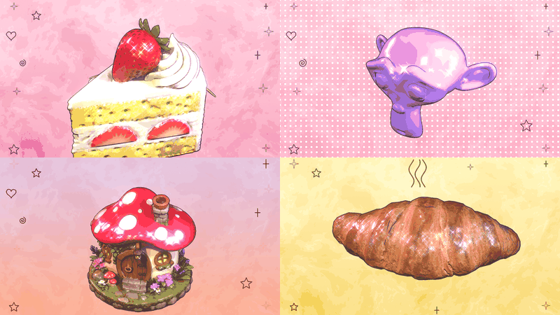

### Cualquier modelo

Modelos de la autora, modelos CC0 y el propio mono de Blender. Un clic para cada uno, mismos ajustes; solo cambia el fondo.

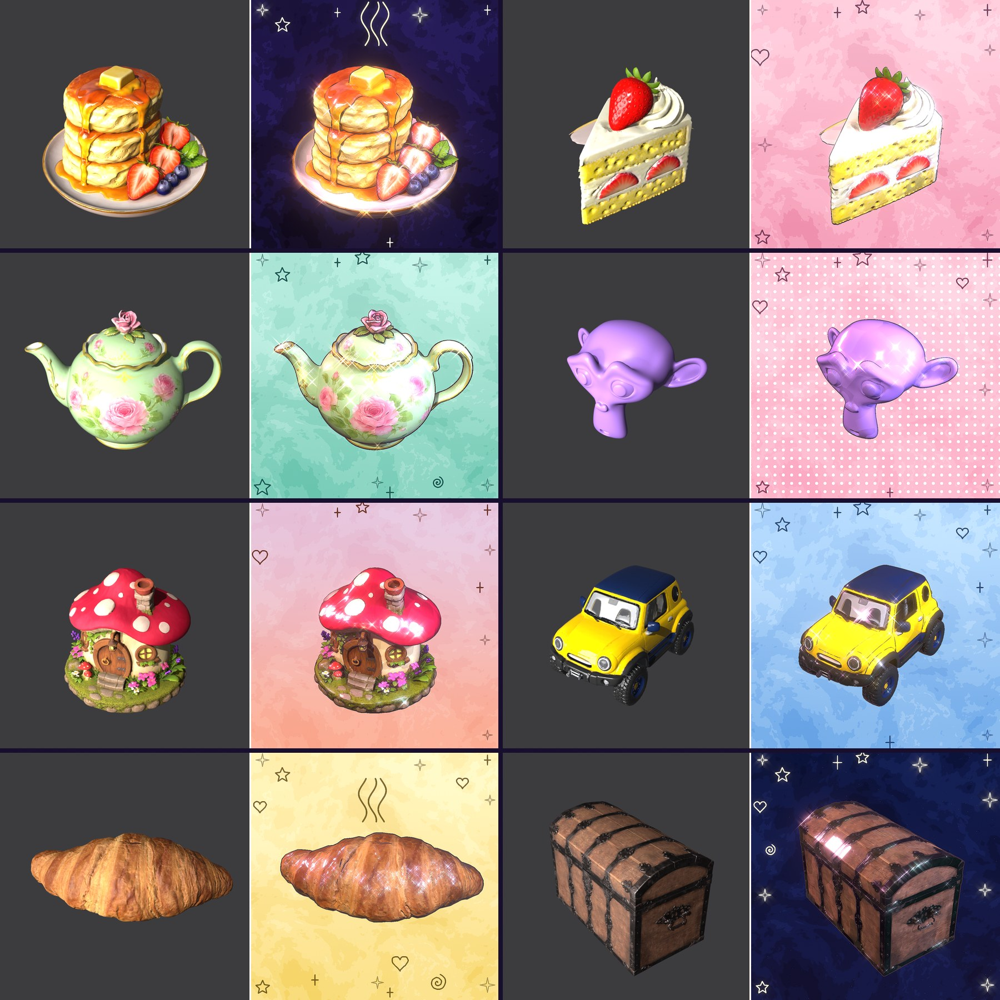

### 10 fondos

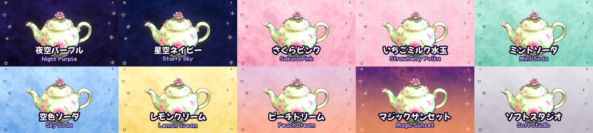

### Capas

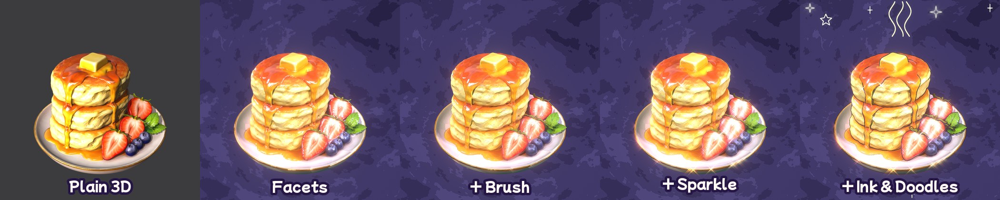

### Cuatro presets

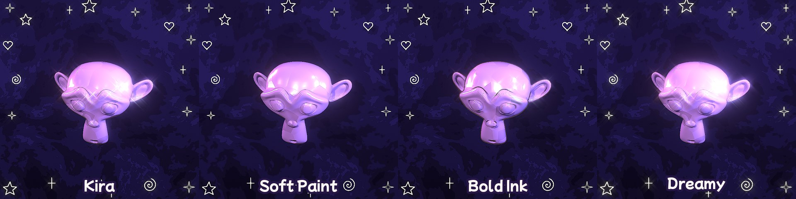

## 🧭 Cómo funciona

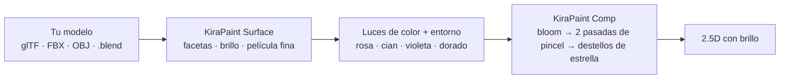

1. **KiraPaint Surface** (shader) se coloca delante de cada Principled BSDF. Inclina la normal en cada celda Voronoi para que la superficie se rompa en pequeñas facetas planas, sube el brillo y añade un arcoíris de película fina.
2. Cada faceta mira hacia un lado distinto, así que cada una refleja una **luz de color o una zona del entorno** diferente. De ahí sale el aspecto de diamante triturado.
3. **KiraPaint Comp** (compositor) repinta la imagen: bloom → enfoque → dos pasadas de Kuwahara anisotrópico → enfoque → mezcla, y después un glare de estrella de cuatro puntas sobre las facetas más brillantes.

## 🚀 Primeros pasos

### Pídeselo a tu agente de IA (recomendado)

Envía esto a un agente de IA que pueda usar tu ordenador, como Claude Code o Codex:

> Sigue el AGENTS.md de https://github.com/kanaworksai-hue/kirapaint para instalar KiraPaint y darle a mi modelo un aspecto pictórico lleno de brillo.

Después, ajusta lo que quieras con tus propias palabras mientras miras la vista previa:

- "Más brillo"
- "Pinceladas más grandes"
- "Un reflejo arcoíris más intenso"
- "Usa el fondo Mint Soda"
- "Sin dibujitos"
- "Añade una transición de realista a pintado y gíralo 60 grados"

### Instálalo tú mismo

**Necesitas:** Blender 5.0 o posterior (probado en 5.1 y 5.2) y el motor de render EEVEE.

1. Descarga `kirapaint-x.y.z.zip` desde [Releases](https://github.com/kanaworksai-hue/kirapaint/releases/latest)
2. Blender → Edit → Preferences → Get Extensions → ▾ (arriba a la derecha) → **Install from Disk…** → elige el zip
3. En la vista 3D pulsa **N** → pestaña **KiraPaint**

### Úsalo

1. Selecciona tu modelo (sin nada seleccionado = todas las mallas de la escena)
2. Elige un estilo (preset) y un fondo
3. **Make It Kira**
4. Mueve el deslizador **2.5D** entre realista y pintado, y afina los detalles en **Look**
5. Renderiza con F12 (las pinceladas salen del compositor, así que aparecen en el render)

<p align="center">
  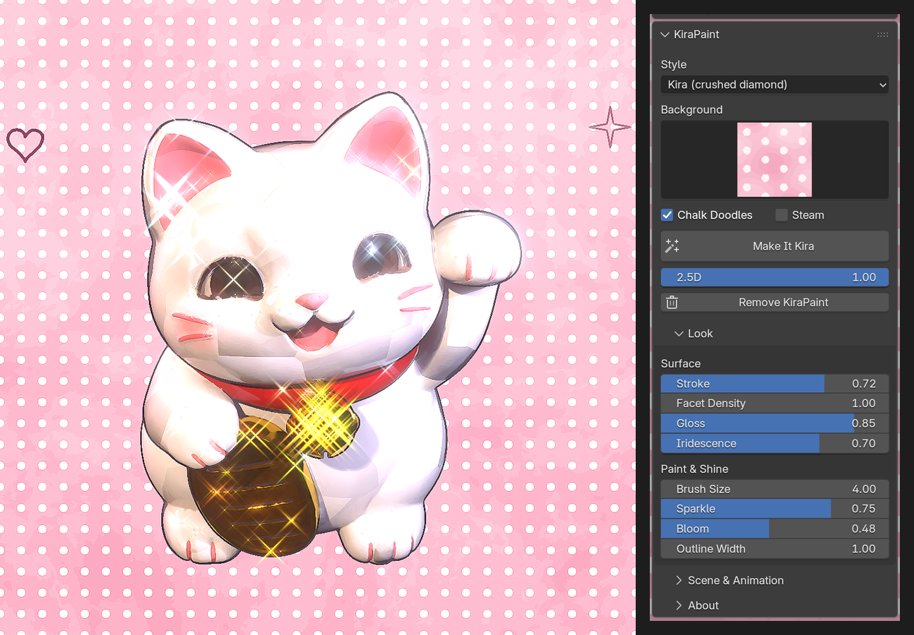
</p>

## 🎛️ Qué puedes ajustar

<details>
<summary><b>El panel Look</b></summary>

| Opción | Qué hace |
|---|---|
| 2.5D | 0 = render normal, 1 = KiraPaint. Admite keyframes |
| Stroke | Cuánto se rompe la superficie en facetas (distorsión de normales) |
| Facet Density | Tamaño de las facetas; 1 = unas 6 a lo ancho del modelo |
| Gloss | Lo cristalinas que se ven las facetas (lleva la rugosidad hacia 0.06) |
| Iridescence | Arcoíris de película fina rosa / cian |
| Brush Size | Tamaño del pincel en píxeles a 1080p, escalado a tu resolución |
| Sparkle | Intensidad de los destellos de estrella y brillo de las luces de destello |
| Bloom | Resplandor suave |
| Outline Width | Grosor del contorno, relativo al tamaño del modelo. 0 = sin contorno |
| Background | Uno de los 10 fondos (elige una miniatura) o Keep Mine (tu World) |
| Chalk Doodles / Steam | Dibujitos y líneas de vapor |

</details>

<details>
<summary><b>Presets</b></summary>

| Preset | Aspecto |
|---|---|
| **Kira** (por defecto) | Facetas brillantes, destellos de color, chispas de estrella: diamante triturado |
| **Soft Paint** | Óleo suave, pocos destellos |
| **Bold Ink** | Contorno grueso, pinceladas nítidas |
| **Dreamy** | Arcoíris y resplandor intensos |
</details>

<details>
<summary><b>Animación</b></summary>

En el panel **Scene & Animation**:

- **Add Reveal:** pone keyframes en 2.5D de 0 a 1 desde el fotograma actual: lo realista se convierte en pintado.
- **Add Turntable:** emparenta el modelo a un empty en su centro y lo hace girar. Las luces y la cámara se quedan quietas, así que los destellos se deslizan por las facetas.
- **Re-aim Lights / Redraw Doodles:** úsalos después de mover la cámara.
</details>

## ❓ Preguntas frecuentes

<details>
<summary><b>¿Tiene interfaz en japonés?</b></summary>

Sí. Con Blender en japonés (Edit → Preferences → Interface → Translation), el panel, las descripciones emergentes y los mensajes pasan a japonés automáticamente. Para dejar Blender en inglés y ver solo KiraPaint en japonés, elige 日本語 en el menú 🌐 de la esquina superior derecha del panel (también en las preferencias del add-on).

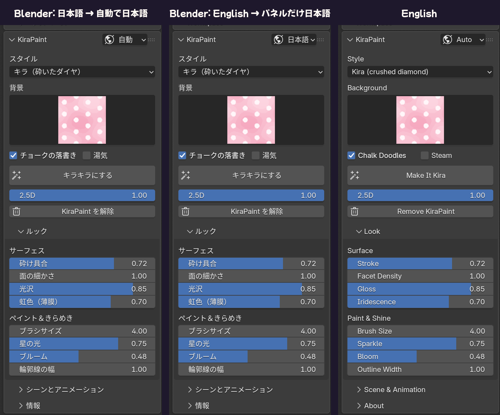
</details>

<details>
<summary><b>¿Funciona en Cycles?</b></summary>

La parte del material sí, pero las pinceladas y los destellos de estrella salen del compositor y el aspecto está pensado para EEVEE. **Make It Kira** cambia la escena a EEVEE.
</details>

<details>
<summary><b>No veo las pinceladas en el viewport.</b></summary>

Las añade el compositor, así que aparecen en los renders con F12. Para verlas en el viewport, pon la opción Compositor del sombreado del viewport en "Always".
</details>

<details>
<summary><b>Se ve deslavado.</b></summary>

Los modelos de color crema o blanco reciben mucha luz. Baja un poco **Sparkle** y **Gloss**. Los modelos oscuros (bronce, madera, calabazas) quedan genial con **Iridescence** alto.
</details>

<details>
<summary><b>¿Qué pasa con mis materiales?</b></summary>

No se sustituye nada. Se inserta un nodo "KiraPaint Surface" delante de cada Principled BSDF y se recuerdan las conexiones y valores originales. **Remove KiraPaint** los restaura. Los materiales sin Principled BSDF (materiales toon de MochiToon, materiales solo de emisión) se omiten y se avisa de ello.
</details>

<details>
<summary><b>¿Puedo usar mis renders con fines comerciales?</b></summary>

Sí. Las imágenes y vídeos que hagas con KiraPaint son obra tuya. La GPL cubre el código del add-on, no lo que creas con él (eso sí, respeta las licencias de los modelos y texturas que uses). No hace falta dar créditos, pero `Made with KiraPaint by @KanaWorks_AI` siempre es bienvenido.
</details>

## 📝 Créditos

KiraPaint es gratis, también para uso comercial.

**Cuando redistribuyas, modifiques o incluyas el add-on en otro producto** (forks, versiones modificadas, ports, packs o productos que lo incluyan, gratis o de pago), es **obligatorio** mantener esta línea, sin cambios, en la descripción del add-on y en su documentación (término adicional de la sección 7(b) de la GPLv3; consulta [NOTICE.md](NOTICE.md)):

```
KiraPaint by KanaWorks_AI (@KanaWorks_AI) — https://github.com/kanaworksai-hue/kirapaint
```

**Las imágenes y vídeos que hagas** no necesitan créditos. Si quieres añadirlos, esta línea en la publicación o la descripción es muy bienvenida:

```
Made with KiraPaint by @KanaWorks_AI
```

## ⭐ Apóyalo con una estrella

Si te gusta KiraPaint, una **⭐ Star** en [la página del repositorio](https://github.com/kanaworksai-hue/kirapaint) (arriba a la derecha) ayuda muchísimo. Es gratis y lleva un segundo.

Compartir tus renders en X con [@KanaWorks_AI](https://x.com/KanaWorks_AI) y **#KanaWorksBlender**, o contarnos errores e ideas en [Issues](https://github.com/kanaworksai-hue/kirapaint/issues), hace que sigan llegando actualizaciones.

## 🧩 Add-ons de KanaWorks

Add-ons gratuitos y de código abierto para Blender, de la misma autora. Tu agente de IA puede manejar cualquiera de ellos con una sola frase.

<table>
<tr>
<td align="center" width="50%"><a href="https://github.com/kanaworksai-hue/mochitoon"></a><br><b><a href="https://github.com/kanaworksai-hue/mochitoon">MochiToon</a></b><br><sub>Sombreado toon estilo manga adorable: sombras de color, semitonos de corazones y estrellas, contornos</sub></td>
<td align="center" width="50%"><a href="https://github.com/kanaworksai-hue/kirapaint">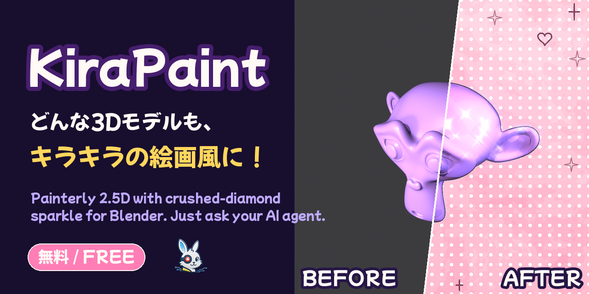</a><br><b>KiraPaint</b> (esta página)<br><sub>2.5D pictórico con brillo: destellos de diamante triturado, pinceladas y chispas de estrella</sub></td>
</tr>
</table>

## 🛠️ Desarrollo

```bash
# prueba rápida
blender -b --factory-startup --python tests/test_ops.py

# antes / después de cualquier modelo
blender -b --factory-startup --python tests/render_demo.py -- model.glb tests/out/demo KIRA 1080 1350

# genera el zip de la release en dist/
blender --factory-startup --command extension build --source-dir kirapaint --output-dir dist
```

```
kirapaint/
  nodes.py     grupos de nodos del shader "KiraPaint Surface" y del compositor "KiraPaint Comp"
  core.py      inserción / restauración de materiales, contorno, luces, World, compositor, animación
  doodles.py   dibujitos de tiza (Grease Pencil)
  api.py       make_kira(): punto de entrada en una sola llamada para agentes y scripts
  ops.py, ui.py  ajustes, operadores, paneles
  presets.py   los cuatro presets
agent/kirapaint_agent.py  línea de comandos para agentes de IA
```

## 📄 Licencia y créditos

- **Este add-on:** Copyright © 2026 東京AI映像合同会社 (Tokyo AI Visuals LLC), publicado bajo [GPL-3.0-or-later](LICENSE) (con un término adicional que exige la atribución al redistribuirlo; consulta [NOTICE.md](NOTICE.md)).
- **Marca:** el nombre KanaWorks_AI, el logotipo y el personaje Kana pertenecen a Tokyo AI Visuals LLC y **no** están cubiertos por la GPL. Consulta [docs/brand](docs/brand/README.md).
- **Modelos de muestra:** modelos de la autora, modelos CC0 y Suzanne de Blender.
- **Técnica:** el render pictórico con filtros Kuwahara y normales distorsionadas con ruido es una técnica muy compartida en la comunidad de Blender.
- **Blender** es una marca registrada de la Blender Foundation. Este es un proyecto independiente, sin afiliación ni respaldo de la Blender Foundation.

<br>

<div align="center">

<a href="https://x.com/KanaWorks_AI"></a>

<p><b>Hecho con ♥ por <a href="https://x.com/KanaWorks_AI">KanaWorks_AI</a></b></p>

<p><sub>Si KiraPaint te ha sido útil, una ⭐ mantiene vivas las actualizaciones. Más proyectos: <a href="https://github.com/kanaworksai-hue">github.com/kanaworksai-hue</a></sub></p>

</div>
