<div align="center">

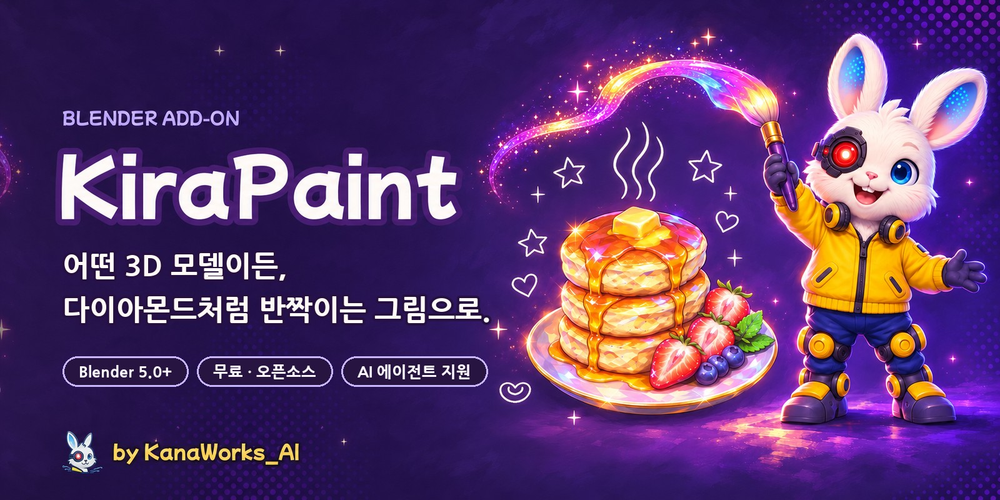

<p>
  <a href="https://github.com/kanaworksai-hue/kirapaint/releases/latest"></a>
  
  
  
  
  <a href="LICENSE"></a>
  <a href="NOTICE.md"></a>
  <a href="https://github.com/kanaworksai-hue/kirapaint/stargazers"></a>
</p>

<p><a href="https://github.com/kanaworksai-hue"></a>&nbsp;<a href="https://github.com/kanaworksai-hue"><b>A KanaWorks_AI project</b></a>&nbsp;·&nbsp;<a href="#-kanaworks-애드온">다른 애드온 보기</a></p>

[日本語](README.md) | [English](README.en.md) | [简体中文](README.zh-CN.md) | **한국어** | [Português](README.pt-BR.md) | [Español](README.es.md)

[🎨 갤러리](#-갤러리) · [🚀 시작하기](#-시작하기) · [🎛️ 조정할 수 있는 항목](#️-조정할-수-있는-항목) · [❓ 자주 묻는 질문](#-자주-묻는-질문) · [⭐ 스타 누르기](#-스타로-응원하기)

</div>

**KiraPaint**는 3D 모델을 반짝반짝 빛나는 회화풍 2.5D로 바꿔 주는 무료 Blender 애드온입니다. 표면을 광택 있는 작은 면(facet)으로 잘게 쪼개 핑크, 시안, 바이올렛, 골드 빛을 비추게 하고, 그 위에 붓 터치를 입힌 뒤 가장 밝은 곳에 별빛 반짝임을 더해요. 손으로 그린 그림 속에 다이아몬드 가루를 뿌린 듯한 느낌이 납니다.

내려받은 모델, 스캔한 모델, AI로 생성한 모델까지 **어떤 모델에도** 쓸 수 있어요. 원래 머티리얼을 바꿔치기하지 않고 그 앞에 살짝 끼어들어 원래 상태를 기억해 두기 때문에, 언제든 되돌릴 수 있습니다. AI 에이전트에게 한 문장만 보내면 설치부터 적용까지 알아서 해 주기도 해요.

<p align="center">
  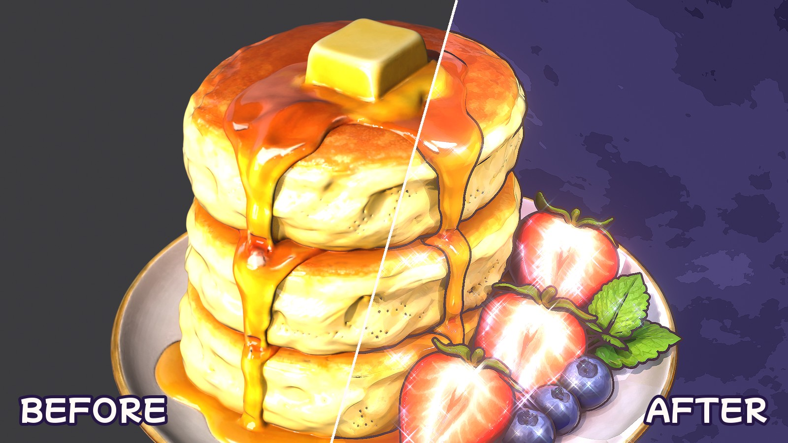
  <br><sub>같은 모델, 같은 카메라. 왼쪽은 일반 렌더, 오른쪽은 KiraPaint를 적용한 결과예요.</sub>
</p>

## ✨ 주요 기능

<table>
<tr>
<td align="center" width="25%">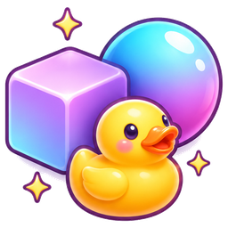<br><b>어떤 모델이든</b><br><sub>glTF, FBX, OBJ, .blend 등 Principled BSDF를 쓰는 모델이라면 OK</sub></td>
<td align="center" width="25%">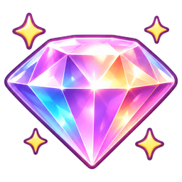<br><b>다이아몬드 가루 같은 반짝임</b><br><sub>광택 있는 면이 컬러 조명을 받아 별빛처럼 반짝여요</sub></td>
<td align="center" width="25%">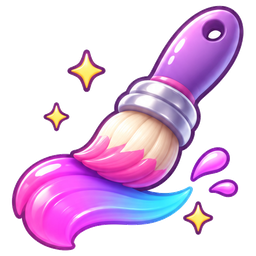<br><b>붓 터치</b><br><sub>붓 크기가 렌더 해상도에 맞춰 자동으로 조정</sub></td>
<td align="center" width="25%"><br><b>AI에게 맡기기</b><br><sub>에이전트에게 한 문장만 보내면 설치, 적용, 미리보기까지 자동</sub></td>
</tr>
</table>

- **언제든 되돌리기:** 머티리얼을 바꿔치기하지 않아요. **Remove**(제거)를 누르면 머티리얼, World, 컴포지터가 원래대로 돌아옵니다.
- **크기는 알아서:** 면 크기와 외곽선 두께는 모델 크기에, 붓 크기는 렌더 해상도에 맞춰 자동으로 정해져요.
- **사실적 ↔ 2.5D를 슬라이더 하나로:** **2.5D** 값에 키프레임을 넣으면 "사진이 그림으로 바뀌는" 연출이 바로 완성돼요.
- **일본어 UI 지원:** Blender를 일본어로 설정하면 KiraPaint도 자동으로 일본어로 표시돼요. 영어 Blender에서도 패널 오른쪽 위 🌐 메뉴에서 「日本語」를 고르면 패널만 일본어로 바꿀 수 있어요.
- **배경 10종:** Night Purple, Starry Sky, Sakura Pink, Strawberry Polka, Mint Soda, Sky Soda, Lemon Cream, Peach Dream, Magic Sunset, Soft Studio. 패널에서 썸네일을 클릭하면 바로 바뀌고, 낙서 색도 배경에 맞춰 함께 바뀝니다.
- **씬 세팅도 클릭 한 번:** EEVEE, 조명 세트(키 라이트, 림 라이트, 스펙큘러 전용 컬러 반짝임 라이트 5개), 배경, 컴포지터까지 한 번에 준비해요.
- **분필 낙서:** 별, 하트, 소용돌이, 반짝이를 모델 위가 아닌 주변에만 배치해요. 음식에는 김도 그려 넣을 수 있어요.

## 🎨 갤러리

### 정지된 3D를 빙글빙글

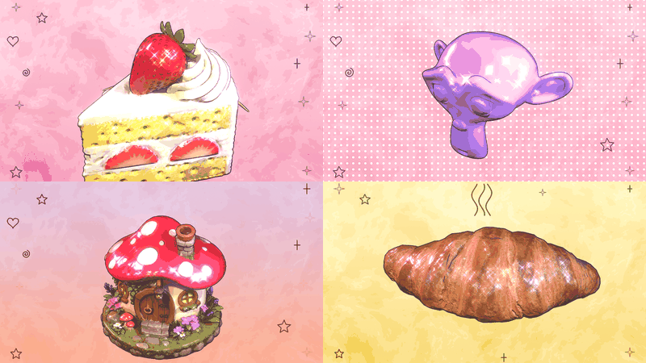

### 어떤 모델이든

제작자의 모델, CC0 모델, Blender 기본 원숭이까지. 모두 같은 설정으로 클릭 한 번씩만 했고, 배경만 바꿨어요.

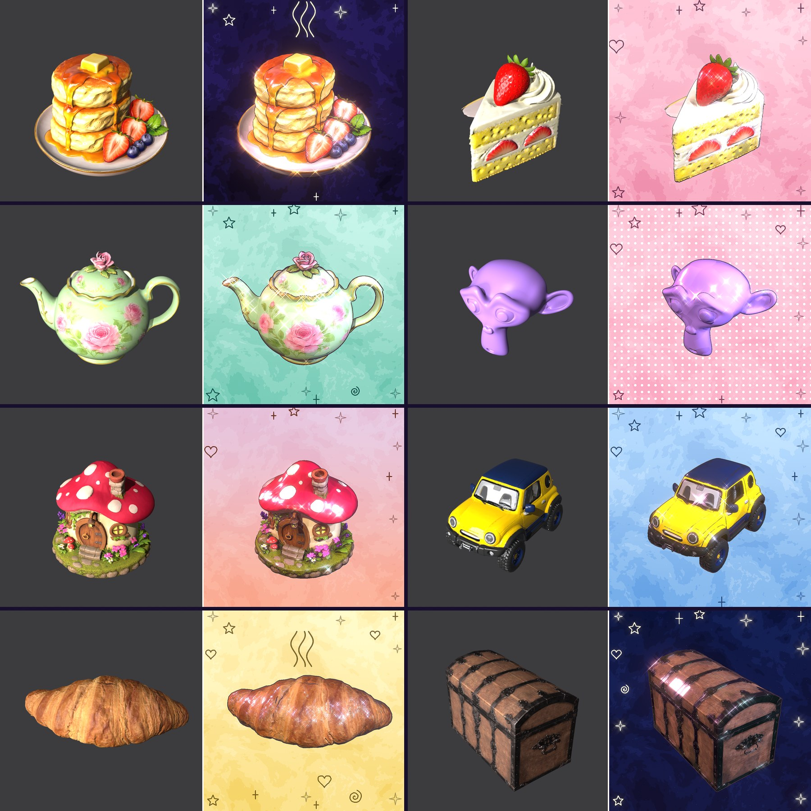

### 배경 10종

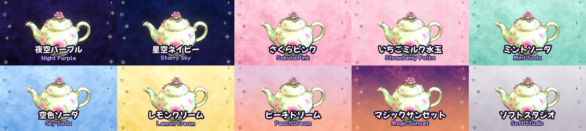

### 레이어

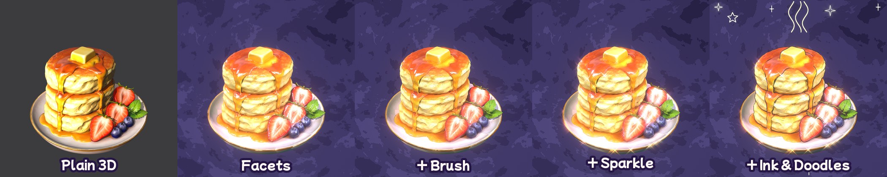

### 프리셋 4종

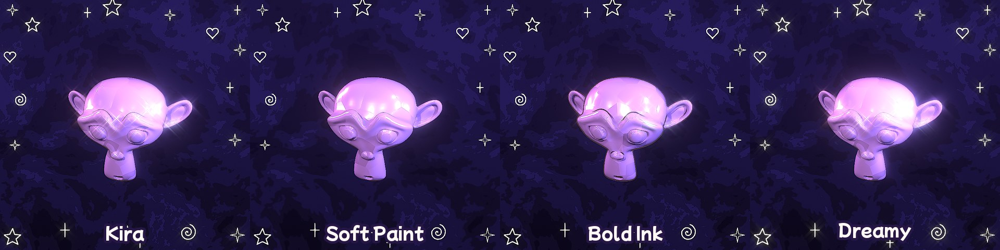

## 🧭 작동 방식

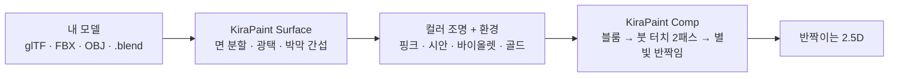

1. **KiraPaint Surface**(셰이더)가 모든 Principled BSDF 앞에 들어갑니다. Voronoi 셀마다 노멀을 기울여 표면을 평평한 작은 면으로 쪼개고, 광택을 높이고, 박막 간섭(thin film)으로 무지갯빛을 더해요.
2. 면마다 향하는 방향이 달라서, 각각 다른 **컬러 조명이나 환경의 일부**를 비추게 됩니다. 이게 바로 다이아몬드 가루 같은 느낌의 비밀이에요.
3. **KiraPaint Comp**(컴포지터)가 이미지를 다시 칠합니다. 블룸 → 샤픈 → 이방성 Kuwahara 2패스 → 샤픈 → 믹스 순서로 처리한 뒤, 가장 밝은 면에 4갈래 별 모양 글레어를 넣어요.

## 🚀 시작하기

### AI 에이전트에게 맡기기 (추천)

Claude Code나 Codex처럼 컴퓨터를 조작할 수 있는 AI 에이전트에게 이렇게 보내 보세요.

> https://github.com/kanaworksai-hue/kirapaint 의 AGENTS.md를 따라서 KiraPaint를 설치하고, 내 모델을 반짝반짝한 회화풍으로 만들어 줘.

그다음엔 미리보기를 보면서 평소 말투로 수정을 요청하면 돼요.

- "더 반짝이게 해 줘"
- "붓 터치를 더 크게"
- "무지갯빛 광택을 더 강하게"
- "배경을 Mint Soda로 바꿔 줘"
- "낙서는 빼 줘"
- "사실적인 모습에서 그림으로 바뀌는 연출을 넣고, 60도 회전시켜 줘"

### 직접 설치하기

**필요한 것:** Blender 5.0 이상(5.1과 5.2에서 테스트됨), EEVEE 렌더 엔진.

1. [Releases](https://github.com/kanaworksai-hue/kirapaint/releases/latest)에서 `kirapaint-x.y.z.zip`을 내려받으세요.
2. Blender → Edit → Preferences → Get Extensions → 오른쪽 위 ▾ 메뉴 → **Install from Disk…** → zip 파일을 선택합니다.
3. 3D 뷰포트에서 **N** 키를 누르고 → **KiraPaint** 탭을 엽니다.

### 사용 방법

1. 모델을 선택합니다(아무것도 선택하지 않으면 씬의 모든 메시에 적용돼요).
2. 스타일(프리셋)과 배경을 고릅니다.
3. **Make It Kira**를 클릭합니다.
4. **2.5D** 슬라이더로 사실적인 느낌과 그림 느낌 사이를 조절하고, **Look**(룩) 패널에서 세부 조정을 합니다.
5. F12로 렌더링합니다(붓 터치는 컴포지터에서 들어가기 때문에 렌더 결과에 나타나요).

<p align="center">
  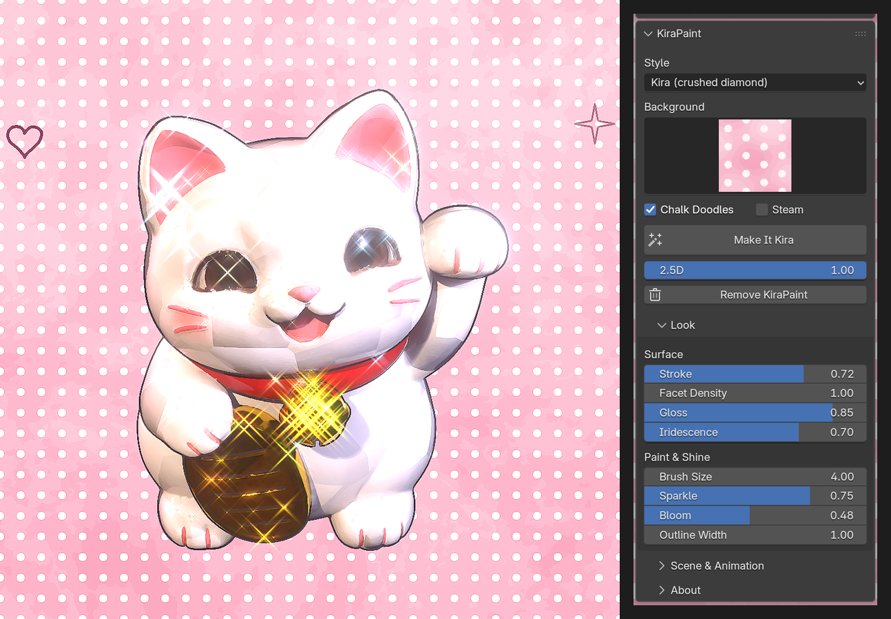
</p>

## 🎛️ 조정할 수 있는 항목

<details>
<summary><b>Look 패널</b></summary>

| 설정 | 설명 |
|---|---|
| 2.5D | 0 = 일반 렌더, 1 = KiraPaint. 키프레임을 넣을 수 있어요 |
| Stroke | 표면이 면으로 쪼개지는 강도(노멀 왜곡) |
| Facet Density | 면 크기. 1이면 모델 폭에 약 6개 |
| Gloss | 면이 얼마나 유리처럼 반짝일지(러프니스를 0.06 쪽으로 낮춤) |
| Iridescence | 핑크 / 시안 박막 무지갯빛 |
| Brush Size | 1080p 기준 붓 크기(픽셀). 해상도에 맞춰 자동 조정 |
| Sparkle | 별빛 반짝임의 강도와 반짝임 라이트의 밝기 |
| Bloom | 부드러운 발광 |
| Outline Width | 외곽선 두께(모델 크기 기준). 0이면 없음 |
| Background | 배경 10종 중 하나(썸네일로 선택) 또는 Keep Mine(내 World 유지) |
| Chalk Doodles / Steam | 낙서와 김 효과 |

</details>

<details>
<summary><b>프리셋</b></summary>

| 프리셋 | 느낌 |
|---|---|
| **Kira** (기본값) | 광택 있는 면, 컬러 반짝임, 별빛: 다이아몬드 가루 느낌 |
| **Soft Paint** | 부드러운 유화 느낌, 반짝임은 적게 |
| **Bold Ink** | 두꺼운 외곽선, 선명한 터치 |
| **Dreamy** | 강한 무지갯빛과 발광 |
</details>

<details>
<summary><b>애니메이션</b></summary>

**Scene & Animation** 패널에서 쓸 수 있어요.

- **Add Reveal:** 현재 프레임부터 2.5D 값을 0에서 1로 키프레임해요. 사실적인 모습이 그림으로 바뀝니다.
- **Add Turntable:** 모델 중심에 Empty를 만들어 부모로 연결하고 회전시켜요. 조명과 카메라는 그대로라서 반짝임이 면 위를 미끄러지듯 흘러갑니다.
- **Re-aim Lights / Redraw Doodles:** 카메라를 옮긴 뒤에 사용하세요.
</details>

## ❓ 자주 묻는 질문

<details>
<summary><b>일본어 UI가 있나요?</b></summary>

네. Blender 언어를 일본어로 설정하면(편집 → 환경 설정 → 인터페이스 → 번역) 패널, 툴팁, 메시지가 자동으로 일본어가 됩니다. Blender는 영어 그대로 두고 KiraPaint만 일본어로 보고 싶다면, KiraPaint 패널 오른쪽 위 🌐 메뉴에서 「日本語」를 선택하세요(애드온 설정에서도 바꿀 수 있어요).

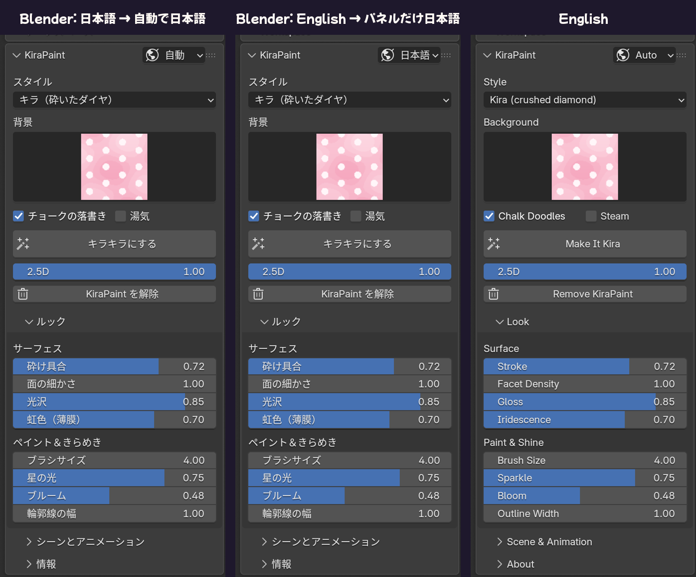
</details>

<details>
<summary><b>Cycles에서도 쓸 수 있나요?</b></summary>

머티리얼 부분은 동작하지만, 붓 터치와 별빛 반짝임은 컴포지터에서 만들어지고 전체 룩도 EEVEE 기준으로 맞춰져 있어요. **Make It Kira**를 누르면 EEVEE로 전환됩니다.
</details>

<details>
<summary><b>뷰포트에서 붓 터치가 안 보여요.</b></summary>

붓 터치는 컴포지터에서 추가되기 때문에 F12 렌더에서 보입니다. 뷰포트에서 확인하려면 뷰포트 셰이딩의 Compositor 옵션을 "Always"로 설정하세요.
</details>

<details>
<summary><b>색이 바랜 것처럼 허옇게 나와요.</b></summary>

크림색이나 흰색 모델은 빛을 많이 받아요. **Sparkle**과 **Gloss**를 조금 낮춰 보세요. 어두운 모델(브론즈, 나무, 호박 등)은 **Iridescence**를 올리면 아주 예쁘게 나옵니다.
</details>

<details>
<summary><b>원래 머티리얼은 어떻게 되나요?</b></summary>

아무것도 바꿔치기하지 않아요. 각 Principled BSDF 앞에 "KiraPaint Surface" 노드를 끼워 넣고, 원래 연결과 값은 따로 기억해 둡니다. **Remove KiraPaint**를 누르면 원래대로 돌아와요. Principled BSDF가 없는 머티리얼(MochiToon 툰 머티리얼, Emission만 있는 머티리얼 등)은 건너뛰고 알려 드립니다.
</details>

<details>
<summary><b>만든 이미지나 영상을 상업적으로 써도 되나요?</b></summary>

네. KiraPaint로 만든 이미지와 영상은 여러분의 작품이에요. GPL은 애드온 코드에만 적용되고, 애드온으로 만든 결과물에는 적용되지 않습니다(사용한 모델과 텍스처의 라이선스는 꼭 지켜 주세요). 크레딧은 필요 없지만 `Made with KiraPaint by @KanaWorks_AI`를 넣어 주시면 기뻐요.
</details>

## 📝 크레딧 표기

KiraPaint는 무료이고 상업적으로도 쓸 수 있어요.

**애드온을 재배포·수정·번들할 때**(포크, 수정판, 이식판, 이 애드온이 포함된 팩이나 제품 등, 유료·무료 불문)는 아래 문구를 애드온 설명과 문서에 그대로 남기는 것이 **필수**입니다(GPL-3.0 제7조 (b)에 따른 추가 조항, 자세한 내용은 [NOTICE.md](NOTICE.md)).

```
KiraPaint by KanaWorks_AI (@KanaWorks_AI) — https://github.com/kanaworksai-hue/kirapaint
```

**만든 이미지나 영상**에는 크레딧이 필요 없어요. 원하신다면 게시글이나 설명란에 이 문구를 넣어 주시면 정말 기쁠 거예요.

```
Made with KiraPaint by @KanaWorks_AI
```

## ⭐ 스타로 응원하기

KiraPaint가 마음에 드셨다면 [저장소 페이지](https://github.com/kanaworksai-hue/kirapaint) 오른쪽 위의 **⭐ Star**를 눌러 주세요. 무료이고 1초면 충분하지만, 저에게는 큰 힘이 돼요.

렌더 작품은 X에서 [@KanaWorks_AI](https://x.com/KanaWorks_AI)와 **#KanaWorksBlender**를 달아 공유해 주시고, 버그 제보나 기능 아이디어는 [Issues](https://github.com/kanaworksai-hue/kirapaint/issues)에 남겨 주세요. 업데이트를 이어 가는 원동력이 됩니다.

## 🧩 KanaWorks 애드온

같은 제작자가 만든 무료 오픈소스 Blender 애드온이에요. 모두 AI 에이전트에게 한 문장만 보내면 바로 쓸 수 있습니다.

<table>
<tr>
<td align="center" width="50%"><a href="https://github.com/kanaworksai-hue/kirapaint">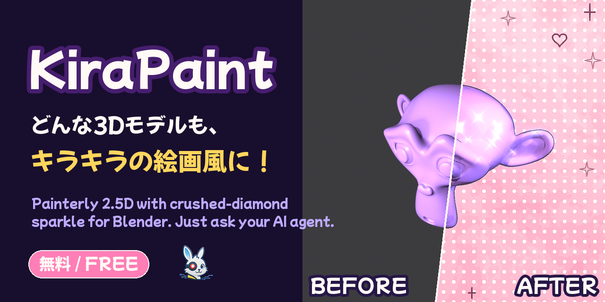</a><br><b>KiraPaint</b> (이 페이지)<br><sub>반짝이는 회화풍 2.5D: 다이아몬드 가루 같은 광택, 붓 터치, 별빛 반짝임</sub></td>
<td align="center" width="50%"><a href="https://github.com/kanaworksai-hue/harappa"></a><br><b><a href="https://github.com/kanaworksai-hue/harappa">Harappa</a></b><br><sub>애니 배경풍 초원, 나무, 하늘에 연못, 폭포, 날씨까지 클릭 한 번으로</sub></td>
</tr>
<tr>
<td align="center" width="50%"><a href="https://github.com/kanaworksai-hue/senga-sketch"></a><br><b><a href="https://github.com/kanaworksai-hue/senga-sketch">Senga Sketch</a></b><br><sub>3D를 펜화 선화로: 해칭, 연필, 판화, 스크린톤</sub></td>
<td align="center" width="50%"><a href="https://github.com/kanaworksai-hue/painterly-25d"></a><br><b><a href="https://github.com/kanaworksai-hue/painterly-25d">Painterly 2.5D</a></b><br><sub>3D를 손으로 칠한 그림으로: 유화, 수채화, 크레용, 애니 셀</sub></td>
</tr>
<tr>
<td align="center" width="50%"><a href="https://github.com/kanaworksai-hue/mochitoon"></a><br><b><a href="https://github.com/kanaworksai-hue/mochitoon">MochiToon</a></b><br><sub>3D를 귀여운 코믹풍으로: 컬러 그림자, 하트와 별 하프톤</sub></td>
<td align="center" width="50%"></td>
</tr>
</table>

## 🛠️ 개발

```bash
# smoke test
blender -b --factory-startup --python tests/test_ops.py

# before / after of any model
blender -b --factory-startup --python tests/render_demo.py -- model.glb tests/out/demo KIRA 1080 1350

# build the release zip into dist/
blender --factory-startup --command extension build --source-dir kirapaint --output-dir dist
```

```
kirapaint/
  nodes.py     "KiraPaint Surface" shader and "KiraPaint Comp" compositor node groups
  core.py      material insert / restore, outline, lights, world, compositor, animation
  doodles.py   chalk doodles (Grease Pencil)
  api.py       make_kira(): one-call entry point for agents and scripts
  ops.py, ui.py  settings, operators, panels
  presets.py   the four presets
agent/kirapaint_agent.py  command line for AI agents
```

## 📄 라이선스 및 크레딧

- **이 애드온:** Copyright © 2026 東京AI映像合同会社 (Tokyo AI Visuals LLC), [GPL-3.0-or-later](LICENSE)로 배포합니다 (재배포 시 크레딧 표기를 요구하는 추가 조항 포함, [NOTICE.md](NOTICE.md)).
- **브랜드:** KanaWorks_AI라는 이름과 로고, 캐릭터 Kana는 Tokyo AI Visuals LLC의 소유이며 GPL 적용 대상이 **아닙니다**. 자세한 내용은 [docs/brand](docs/brand/README.md)를 참고하세요.
- **샘플 모델:** 제작자의 모델, CC0 모델, Blender의 Suzanne을 사용했습니다.
- **기법:** Kuwahara 필터와 노이즈로 왜곡한 노멀을 이용한 회화풍 렌더링은 Blender 커뮤니티에서 널리 공유되어 온 기법입니다.
- **Blender**는 Blender Foundation의 상표입니다. 이 프로젝트는 독립 프로젝트이며, Blender Foundation과 제휴하거나 보증을 받은 것이 아닙니다.

<br>

<div align="center">

<a href="https://x.com/KanaWorks_AI"></a>

<p><b>Made with ♥ by <a href="https://x.com/KanaWorks_AI">KanaWorks_AI</a></b></p>

<p><sub>KiraPaint가 도움이 되었다면 ⭐ 하나가 업데이트를 이어 가는 힘이 됩니다. 다른 프로젝트: <a href="https://github.com/kanaworksai-hue">github.com/kanaworksai-hue</a></sub></p>

</div>
