<div align="center">

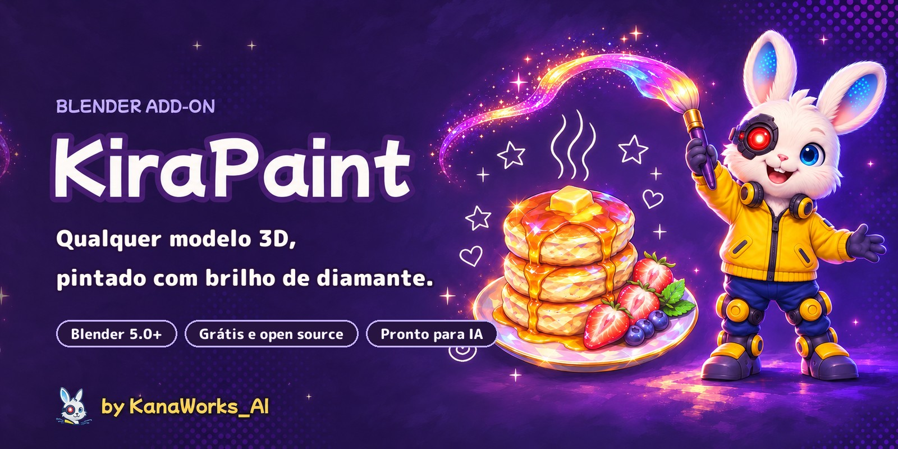

<p>
  <a href="https://github.com/kanaworksai-hue/kirapaint/releases/latest"></a>
  
  
  
  
  <a href="LICENSE"></a>
  <a href="NOTICE.md"></a>
  <a href="https://github.com/kanaworksai-hue/kirapaint/stargazers"></a>
</p>

<p><a href="https://github.com/kanaworksai-hue"></a>&nbsp;<a href="https://github.com/kanaworksai-hue"><b>Um projeto KanaWorks_AI</b></a>&nbsp;·&nbsp;<a href="#-add-ons-da-kanaworks">Mais add-ons</a></p>

[日本語](README.md) | [English](README.en.md) | [简体中文](README.zh-CN.md) | [한국어](README.ko.md) | **Português** | [Español](README.es.md)

[🎨 Galeria](#-galeria) · [🚀 Primeiros passos](#-primeiros-passos) · [🎛️ O que dá para ajustar](#️-o-que-dá-para-ajustar) · [❓ Perguntas frequentes](#-perguntas-frequentes) · [⭐ Deixe uma estrela](#-apoie-com-uma-estrela)

</div>

**KiraPaint** é um add-on gratuito para Blender que transforma modelos 3D em um visual 2.5D pintado e cintilante. Ele quebra a superfície em pequenas facetas brilhantes, faz cada uma refletir luz rosa, ciano, violeta e dourada, pinta a imagem por cima com pinceladas e coloca reflexos em estrela nos pontos mais claros — como diamante triturado em um quadro pintado à mão.

Funciona com **qualquer modelo**: baixado, escaneado ou gerado por IA. Ele nunca substitui os seus materiais — entra na frente deles e guarda como estavam, então dá para voltar atrás quando quiser. Você também pode pedir para um agente de IA instalar e aplicar tudo com uma frase.

<p align="center">
  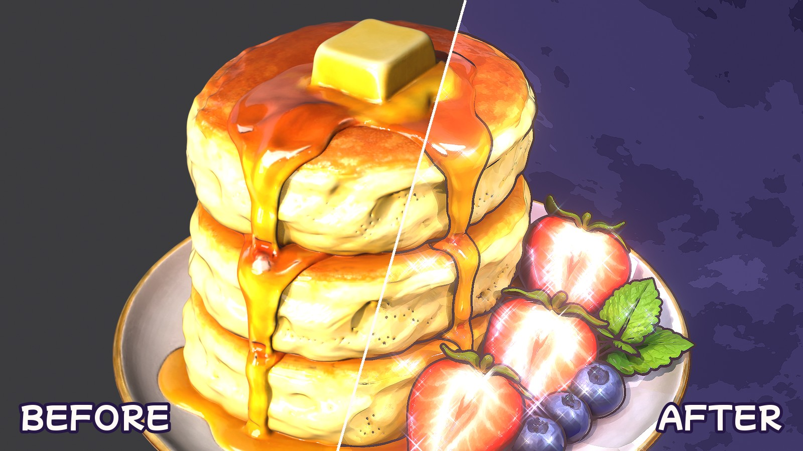
  <br><sub>Mesmo modelo, mesma câmera. Esquerda: render normal. Direita: KiraPaint.</sub>
</p>

## ✨ Recursos

<table>
<tr>
<td align="center" width="25%">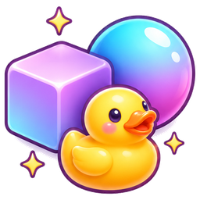<br><b>Qualquer modelo</b><br><sub>glTF, FBX, OBJ, .blend — qualquer coisa com Principled BSDF</sub></td>
<td align="center" width="25%">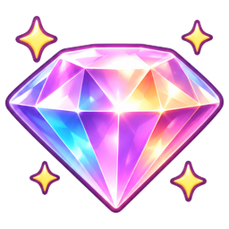<br><b>Brilho de diamante triturado</b><br><sub>Facetas brilhantes captam luz colorida e cintilam com reflexos em estrela</sub></td>
<td align="center" width="25%">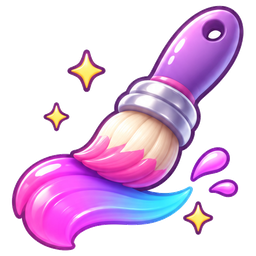<br><b>Pinceladas</b><br><sub>O tamanho do pincel acompanha a resolução do render automaticamente</sub></td>
<td align="center" width="25%"><br><b>Peça para a sua IA</b><br><sub>Uma frase para o seu agente: instalação, aplicação e prévia</sub></td>
</tr>
</table>

- **Totalmente reversível:** seus materiais nunca são substituídos. O **Remove** devolve materiais, world e compositor como estavam.
- **Se ajusta sozinho:** o tamanho das facetas e a espessura do contorno acompanham o tamanho do modelo; o tamanho do pincel acompanha a resolução do render.
- **Realista ↔ 2.5D em um slider só:** coloque keyframes no **2.5D** e você ganha de brinde a transição de "foto que vira pintura".
- **Interface em japonês:** com o Blender em japonês, o KiraPaint muda para japonês sozinho. Num Blender em inglês, escolha 日本語 no menu 🌐 no canto superior direito do painel para mostrar só o painel em japonês.
- **10 fundos:** Night Purple, Starry Sky, Sakura Pink, Strawberry Polka, Mint Soda, Sky Soda, Lemon Cream, Peach Dream, Magic Sunset e Soft Studio. Clique em uma miniatura no painel para trocar; os rabiscos mudam de cor para combinar.
- **Cena em um clique:** EEVEE, um esquema de luz (luz principal, luzes de recorte e cinco luzes coloridas só de especular para os reflexos), o fundo e o compositor.
- **Rabiscos de giz:** estrelas, corações, espirais e brilhinhos espalhados em volta do modelo, nunca em cima dele. E vapor para comida.

## 🎨 Galeria

### 3D parado: gire à vontade

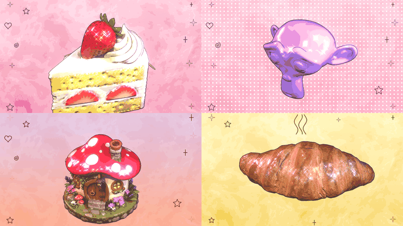

### Qualquer modelo

Modelos da própria autora, modelos CC0 e o macaquinho do próprio Blender. Um clique em cada, mesmas configurações; só o fundo muda.

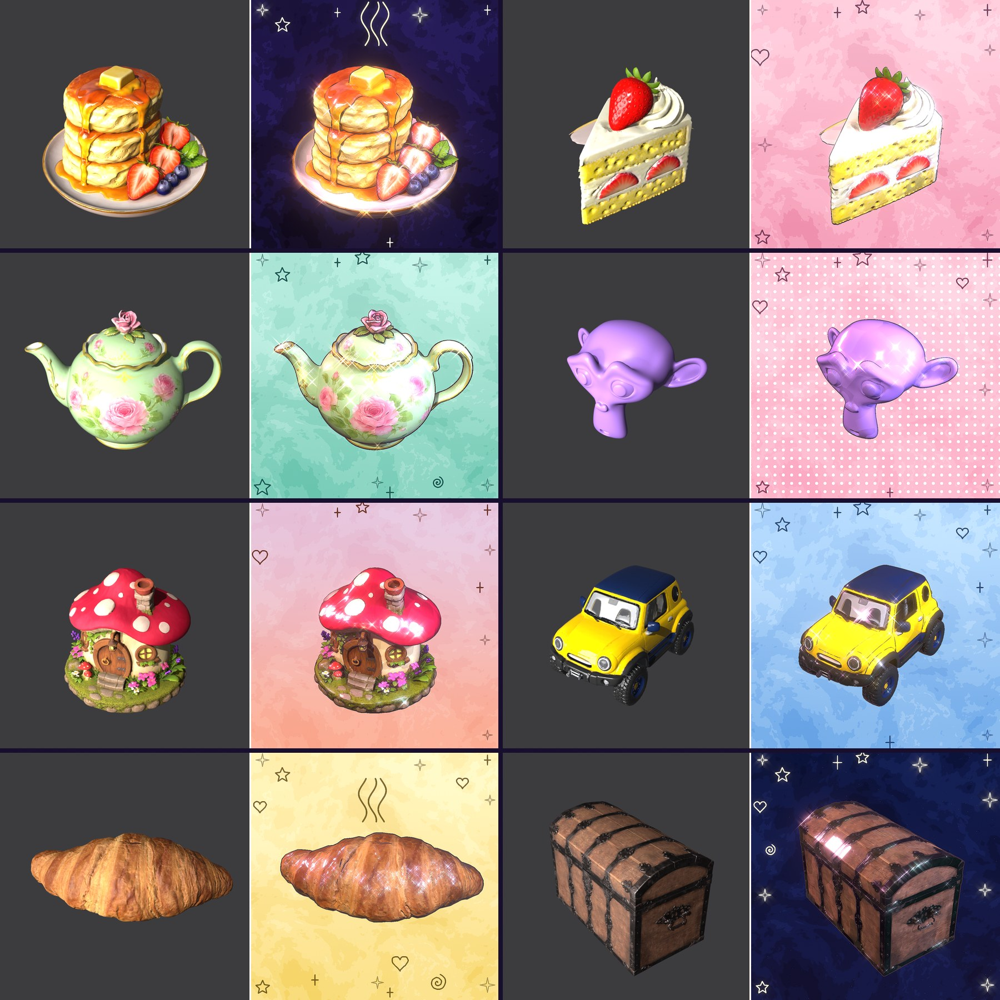

### 10 fundos

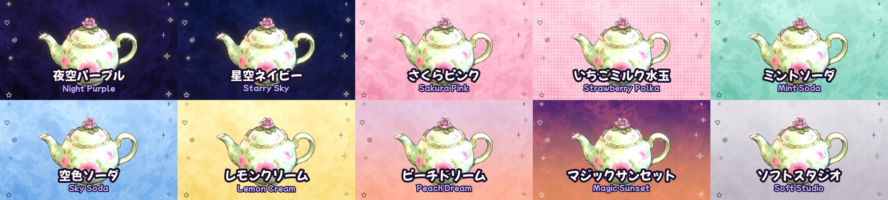

### Camadas

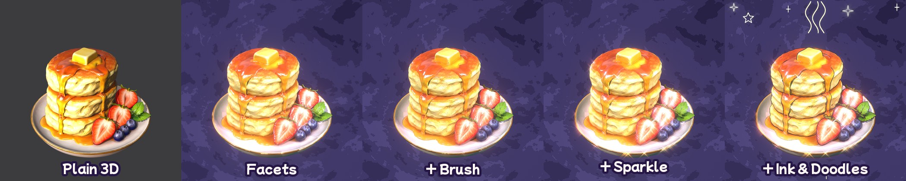

### Quatro presets

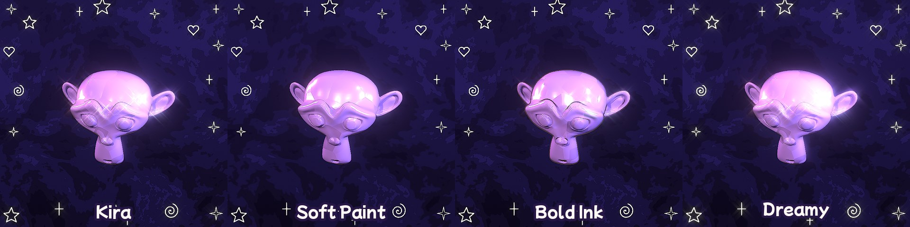

## 🧭 Como funciona

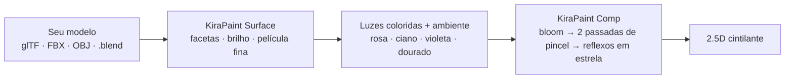

1. **KiraPaint Surface** (shader) entra na frente de cada Principled BSDF. Ele inclina a normal em cada célula de Voronoi para a superfície se quebrar em pequenas facetas planas, aumenta o brilho e adiciona um arco-íris de película fina.
2. Cada faceta aponta para um lado diferente, então cada uma reflete uma **luz colorida ou um pedaço do ambiente** diferente. É daí que vem o visual de diamante triturado.
3. **KiraPaint Comp** (compositor) repinta a imagem: bloom → nitidez → duas passadas de Kuwahara anisotrópico → nitidez → mistura e, por fim, um glare em estrela de quatro pontas nas facetas mais claras.

## 🚀 Primeiros passos

### Peça para o seu agente de IA (recomendado)

Mande isto para um agente de IA que consiga usar o seu computador, como o Claude Code ou o Codex:

> Siga o AGENTS.md de https://github.com/kanaworksai-hue/kirapaint para instalar o KiraPaint e deixar o meu modelo cintilante e com cara de pintura.

Depois, é só ir ajustando com suas próprias palavras enquanto olha a prévia:

- "Mais brilho"
- "Pinceladas maiores"
- "Reflexo de arco-íris mais forte"
- "Usa o fundo Mint Soda"
- "Sem rabiscos"
- "Coloca uma transição de realista para pintado e gira 60 graus"

### Instalar manualmente

**Você precisa de:** Blender 5.0 ou mais recente (testado no 5.1 e no 5.2) e o motor de render EEVEE.

1. Baixe o `kirapaint-x.y.z.zip` em [Releases](https://github.com/kanaworksai-hue/kirapaint/releases/latest)
2. Blender → Edit → Preferences → Get Extensions → ▾ (canto superior direito) → **Install from Disk…** → escolha o zip
3. No 3D Viewport, aperte **N** → aba **KiraPaint**

### Como usar

1. Selecione o seu modelo (sem nada selecionado = todas as malhas da cena)
2. Escolha um estilo (preset) e um fundo
3. **Make It Kira**
4. Deslize o **2.5D** entre realista e pintado e faça o ajuste fino em **Look**
5. Renderize com F12 (as pinceladas vêm do compositor, então aparecem no render)

<p align="center">
  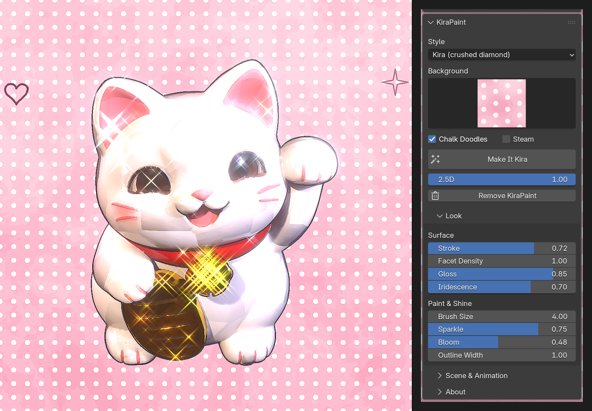
</p>

## 🎛️ O que dá para ajustar

<details>
<summary><b>O painel Look</b></summary>

| Opção | O que faz |
|---|---|
| 2.5D | 0 = render normal, 1 = KiraPaint. Dá para colocar keyframes |
| Stroke | O quanto a superfície se quebra em facetas (distorção da normal) |
| Facet Density | Tamanho das facetas; 1 = umas 6 de um lado a outro do modelo |
| Gloss | O quanto as facetas ficam vítreas (puxa a roughness em direção a 0.06) |
| Iridescence | Arco-íris de película fina rosa / ciano |
| Brush Size | Tamanho do pincel em pixels a 1080p, ajustado à sua resolução |
| Sparkle | Intensidade dos reflexos em estrela e das luzes de reflexo |
| Bloom | Brilho suave |
| Outline Width | Espessura do contorno, relativa ao tamanho do modelo. 0 = sem contorno |
| Background | Um dos 10 fundos (escolha uma miniatura) ou Keep Mine (o seu world) |
| Chalk Doodles / Steam | Rabiscos e linhas de vapor |

</details>

<details>
<summary><b>Presets</b></summary>

| Preset | Visual |
|---|---|
| **Kira** (padrão) | Facetas brilhantes, reflexos coloridos, brilhos em estrela: diamante triturado |
| **Soft Paint** | Tinta a óleo suave, poucos brilhos |
| **Bold Ink** | Contorno grosso, pinceladas bem definidas |
| **Dreamy** | Arco-íris e brilho fortes |
</details>

<details>
<summary><b>Animação</b></summary>

No painel **Scene & Animation**:

- **Add Reveal:** coloca keyframes no 2.5D de 0 a 1 a partir do quadro atual — o realista vira pintura.
- **Add Turntable:** faz do modelo filho de um empty no centro dele e o gira. As luzes e a câmera ficam paradas, então os reflexos deslizam pelas facetas.
- **Re-aim Lights / Redraw Doodles:** use depois de mover a câmera.
</details>

## ❓ Perguntas frequentes

<details>
<summary><b>Tem interface em japonês?</b></summary>

Tem. Com o Blender em japonês (Edit → Preferences → Interface → Translation), o painel, as dicas e as mensagens ficam em japonês automaticamente. Para manter o Blender em inglês e ver só o KiraPaint em japonês, escolha 日本語 no menu 🌐 no canto superior direito do painel (também nas preferências do add-on).

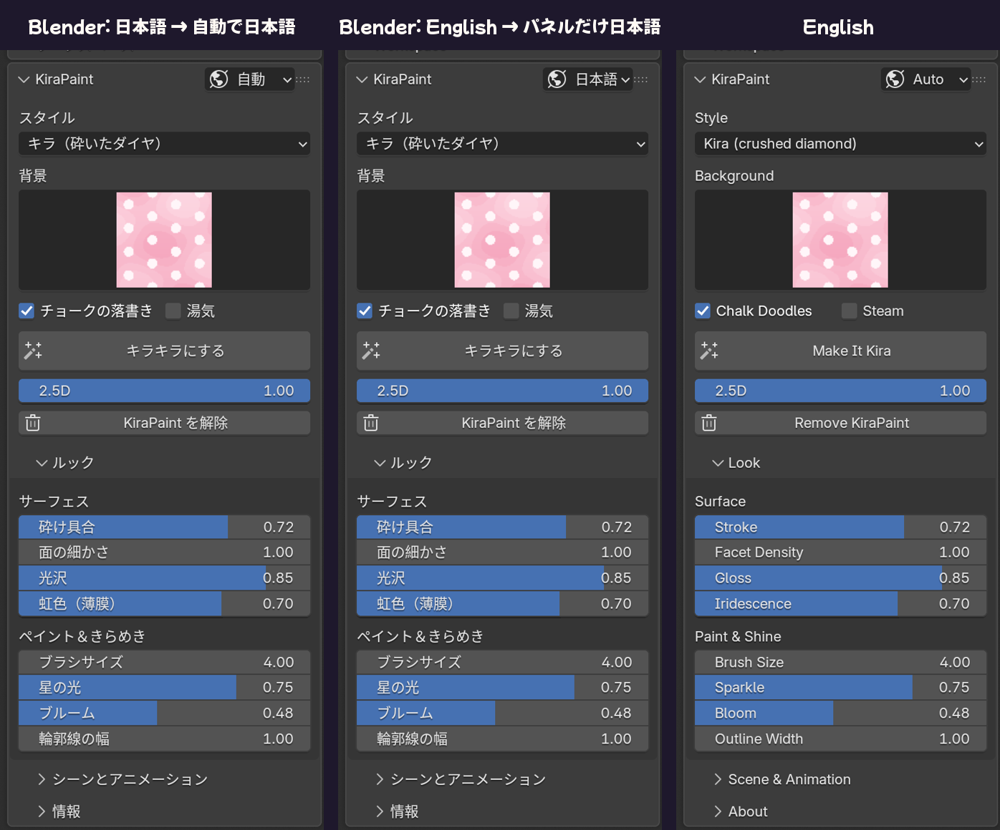
</details>

<details>
<summary><b>Funciona no Cycles?</b></summary>

A parte do material funciona, mas as pinceladas e os reflexos em estrela vêm do compositor, e o visual foi ajustado para o EEVEE. O **Make It Kira** já muda para o EEVEE.
</details>

<details>
<summary><b>Não vejo as pinceladas na viewport.</b></summary>

Elas são adicionadas pelo compositor, então aparecem nos renders com F12. Para vê-las na viewport, coloque a opção Compositor do viewport shading em "Always".
</details>

<details>
<summary><b>Está ficando estourado / desbotado.</b></summary>

Modelos creme e brancos captam muita luz. Abaixe um pouco o **Sparkle** e o **Gloss**. Modelos escuros (bronze, madeira, abóboras) ficam lindos com o **Iridescence** lá em cima.
</details>

<details>
<summary><b>O que acontece com os meus materiais?</b></summary>

Nada é substituído. Um nó "KiraPaint Surface" é inserido na frente de cada Principled BSDF, e as conexões e valores originais ficam guardados. O **Remove KiraPaint** restaura tudo. Materiais sem Principled BSDF (materiais toon do MochiToon, materiais só de emissão) são ignorados e listados no relatório.
</details>

<details>
<summary><b>Posso usar os meus renders comercialmente?</b></summary>

Pode. As imagens e vídeos que você fizer com o KiraPaint são obra sua. A GPL vale para o código do add-on, não para o que você cria com ele (mas respeite as licenças dos modelos e texturas que usar). Não precisa de créditos, mas `Made with KiraPaint by @KanaWorks_AI` é sempre bem-vindo.
</details>

## 📝 Créditos

O KiraPaint é gratuito, inclusive para uso comercial.

**Ao redistribuir, modificar ou incluir o add-on em outro produto** (forks, versões modificadas, ports, pacotes ou produtos que o incluam, gratuitos ou pagos), é **obrigatório** manter esta linha, sem alterações, na descrição do add-on e na documentação (termo adicional da seção 7(b) da GPLv3; veja [NOTICE.md](NOTICE.md)):

```
KiraPaint by KanaWorks_AI (@KanaWorks_AI) — https://github.com/kanaworksai-hue/kirapaint
```

**Imagens e vídeos que você fizer** não precisam de créditos. Se quiser colocar, esta linha no post ou na descrição é muito bem-vinda:

```
Made with KiraPaint by @KanaWorks_AI
```

## ⭐ Apoie com uma estrela

Se você curtiu o KiraPaint, uma **⭐ Star** no canto superior direito da [página do repositório](https://github.com/kanaworksai-hue/kirapaint) ajuda muito. É grátis e leva um segundo.

Mostrar seus renders no X marcando [@KanaWorks_AI](https://x.com/KanaWorks_AI) e com **#KanaWorksBlender**, ou contar sobre bugs e pedidos em [Issues](https://github.com/kanaworksai-hue/kirapaint/issues), é o que mantém as atualizações chegando.

## 🧩 Add-ons da KanaWorks

Add-ons gratuitos e de código aberto para Blender, da mesma autora. Todos podem ser controlados pelo seu agente de IA com uma frase.

<table>
<tr>
<td align="center" width="50%"><a href="https://github.com/kanaworksai-hue/kirapaint">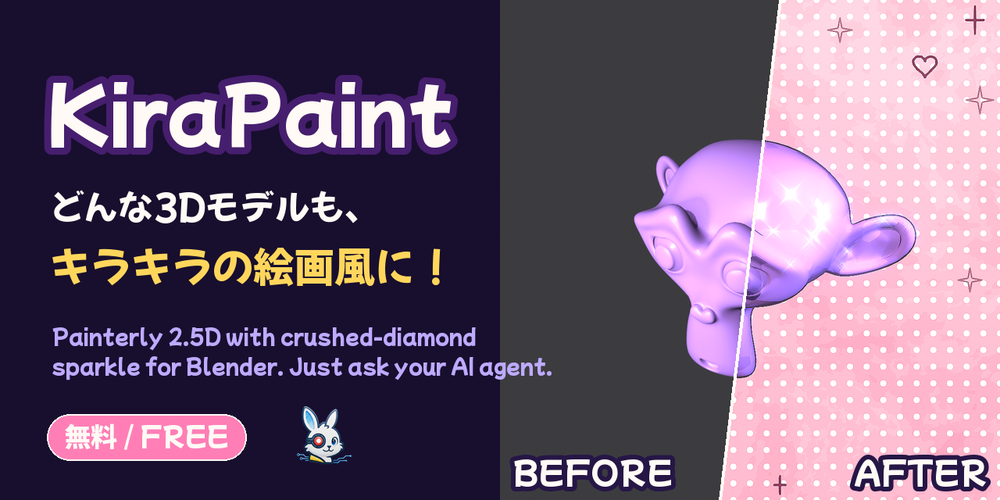</a><br><b>KiraPaint</b> (esta página)<br><sub>2.5D pintado e cintilante: brilho de diamante triturado, pinceladas, reflexos em estrela</sub></td>
<td align="center" width="50%"><a href="https://github.com/kanaworksai-hue/harappa"></a><br><b><a href="https://github.com/kanaworksai-hue/harappa">Harappa</a></b><br><sub>Campos, árvores e céu de cenário de anime, com lagos, cascatas e clima, em um clique</sub></td>
</tr>
<tr>
<td align="center" width="50%"><a href="https://github.com/kanaworksai-hue/senga-sketch"></a><br><b><a href="https://github.com/kanaworksai-hue/senga-sketch">Senga Sketch</a></b><br><sub>Do 3D para arte em traço de nanquim: hachura, lápis, gravura, retícula</sub></td>
<td align="center" width="50%"><a href="https://github.com/kanaworksai-hue/painterly-25d"></a><br><b><a href="https://github.com/kanaworksai-hue/painterly-25d">Painterly 2.5D</a></b><br><sub>Do 3D para arte pintada à mão: óleo, aquarela, giz de cera, cel de anime</sub></td>
</tr>
<tr>
<td align="center" width="50%"><a href="https://github.com/kanaworksai-hue/mochitoon"></a><br><b><a href="https://github.com/kanaworksai-hue/mochitoon">MochiToon</a></b><br><sub>Do 3D para um visual fofo de quadrinhos: sombras coloridas, retículas de coração e estrela</sub></td>
<td align="center" width="50%"></td>
</tr>
</table>

## 🛠️ Desenvolvimento

```bash
# smoke test
blender -b --factory-startup --python tests/test_ops.py

# before / after of any model
blender -b --factory-startup --python tests/render_demo.py -- model.glb tests/out/demo KIRA 1080 1350

# build the release zip into dist/
blender --factory-startup --command extension build --source-dir kirapaint --output-dir dist
```

```
kirapaint/
  nodes.py     "KiraPaint Surface" shader and "KiraPaint Comp" compositor node groups
  core.py      material insert / restore, outline, lights, world, compositor, animation
  doodles.py   chalk doodles (Grease Pencil)
  api.py       make_kira(): one-call entry point for agents and scripts
  ops.py, ui.py  settings, operators, panels
  presets.py   the four presets
agent/kirapaint_agent.py  command line for AI agents
```

## 📄 Licença e créditos

- **Este add-on:** Copyright © 2026 東京AI映像合同会社 (Tokyo AI Visuals LLC), distribuído sob a [GPL-3.0-or-later](LICENSE) (com um termo adicional que exige atribuição na redistribuição; veja [NOTICE.md](NOTICE.md)).
- **Marca:** o nome KanaWorks_AI, o logo e a personagem Kana pertencem à Tokyo AI Visuals LLC e **não** são cobertos pela GPL. Veja [docs/brand](docs/brand/README.md).
- **Modelos de exemplo:** modelos da própria autora, modelos CC0 e a Suzanne do Blender.
- **Técnica:** renderização com cara de pintura usando filtros Kuwahara e normais distorcidas por ruído é uma técnica amplamente compartilhada na comunidade Blender.
- **Blender** é marca registrada da Blender Foundation. Este é um projeto independente, sem afiliação nem endosso da Blender Foundation.

<br>

<div align="center">

<a href="https://x.com/KanaWorks_AI">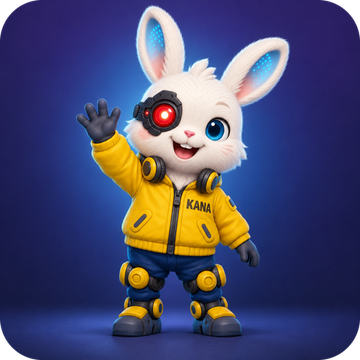</a>

<p><b>Feito com ♥ por <a href="https://x.com/KanaWorks_AI">KanaWorks_AI</a></b></p>

<p><sub>Se o KiraPaint te ajudou, uma ⭐ mantém as atualizações chegando. Mais projetos: <a href="https://github.com/kanaworksai-hue">github.com/kanaworksai-hue</a></sub></p>

</div>
