<div align="center">

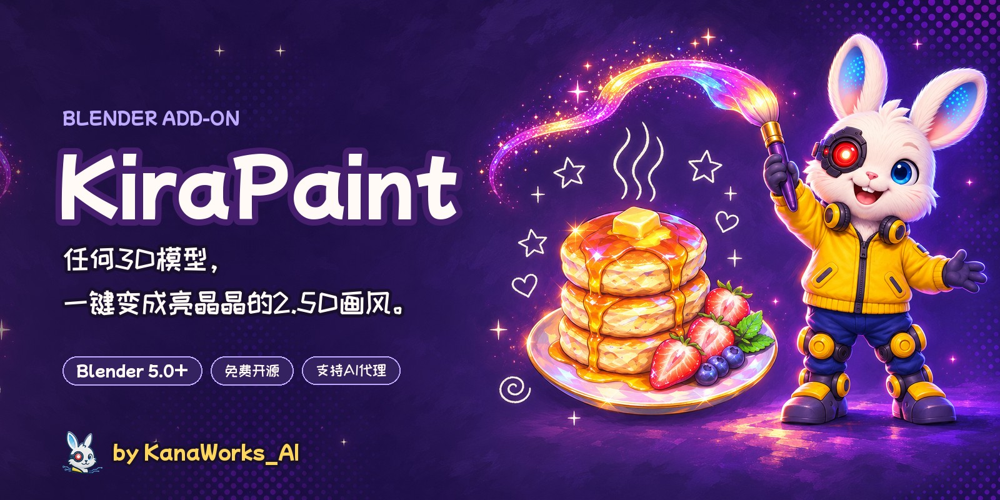

<p>
  <a href="https://github.com/kanaworksai-hue/kirapaint/releases/latest"></a>
  
  
  
  
  <a href="LICENSE"></a>
  <a href="https://github.com/kanaworksai-hue/kirapaint/stargazers"></a>
</p>

<p><a href="https://github.com/kanaworksai-hue"></a>&nbsp;<a href="https://github.com/kanaworksai-hue"><b>KanaWorks_AI 的项目</b></a>&nbsp;·&nbsp;<a href="#-kanaworks-插件">更多插件</a></p>

[日本語](README.md) | [English](README.en.md) | **简体中文**

[🎨 效果展示](#-效果展示) · [🚀 开始使用](#-开始使用) · [🎛️ 可以调什么](#️-可以调什么) · [❓ 常见问题](#-常见问题) · [⭐ 点个 Star](#-点个-star)

</div>

**KiraPaint** 是一个免费的 Blender 插件，把 3D 模型变成亮晶晶的绘画风 2.5D。它把表面打碎成一块块有光泽的小斜面，让它们反射粉、青、紫、金色的光，再用笔触重新涂一遍，最后在最亮的地方加上星芒，看起来就像撒了一层碎钻的手绘画。

**任何模型都能用**：下载的、扫描的、AI 生成的都可以。它不会替换你的材质，只是在材质前面插入处理，并记住原来的连接，随时可以还原。也可以跟 AI 代理说一句话，让它帮你安装并应用。

<p align="center">
  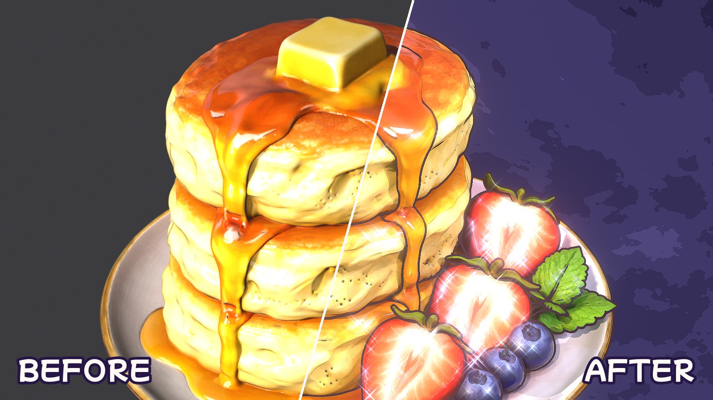
  <br><sub>同一个模型、同一个相机。左边是普通渲染，右边是 KiraPaint。</sub>
</p>

## ✨ 特点

<table>
<tr>
<td align="center" width="25%">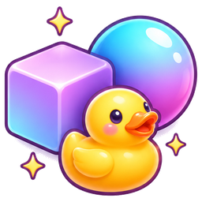<br><b>任何模型都能用</b><br><sub>glTF、FBX、OBJ、.blend，只要是 Principled BSDF 材质</sub></td>
<td align="center" width="25%">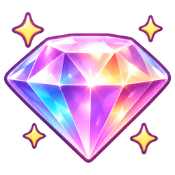<br><b>碎钻般的光泽</b><br><sub>小斜面反射彩色的光，再加上星芒闪光</sub></td>
<td align="center" width="25%">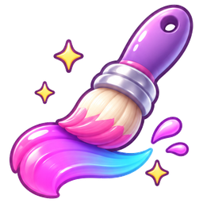<br><b>笔触感</b><br><sub>笔触大小跟着渲染分辨率自动换算</sub></td>
<td align="center" width="25%"><br><b>交给 AI</b><br><sub>跟代理说一句话，安装、应用、预览全自动</sub></td>
</tr>
</table>

- **可以完全还原：** 不替换材质。点 **Remove** 就能把材质、环境和合成器恢复原样。
- **自动适配大小：** 碎面大小和描边粗细按模型尺寸自动计算，笔触大小按渲染分辨率自动计算。
- **一个滑杆切换写实和 2.5D：** 给 **2.5D** 打关键帧，就能做出"照片变成画"的过渡动画。
- **10 种背景：** 夜空紫、星空蓝、樱花粉、草莓牛奶波点、薄荷苏打、天空苏打、柠檬奶油、蜜桃梦、魔法晚霞、柔光影棚。在面板里点缩略图就能切换，涂鸦的颜色也会跟着背景变。
- **一键设置场景：** EEVEE、整套灯光（主光、轮廓光、5 盏只产生高光的彩色灯）、背景，以及合成节点。
- **粉笔涂鸦：** 星星、爱心、漩涡、闪光会自动画在模型周围，不会挡住模型。食物还可以加热气。

## 🎨 效果展示

### 依然是 3D，可以转起来看

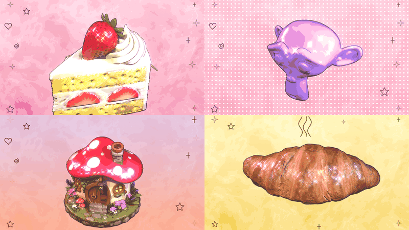

### 任何模型都能用

作者自己的模型、CC0 模型和 Blender 自带的猴头，每个都只点一次按钮，设置完全相同，只换了背景。

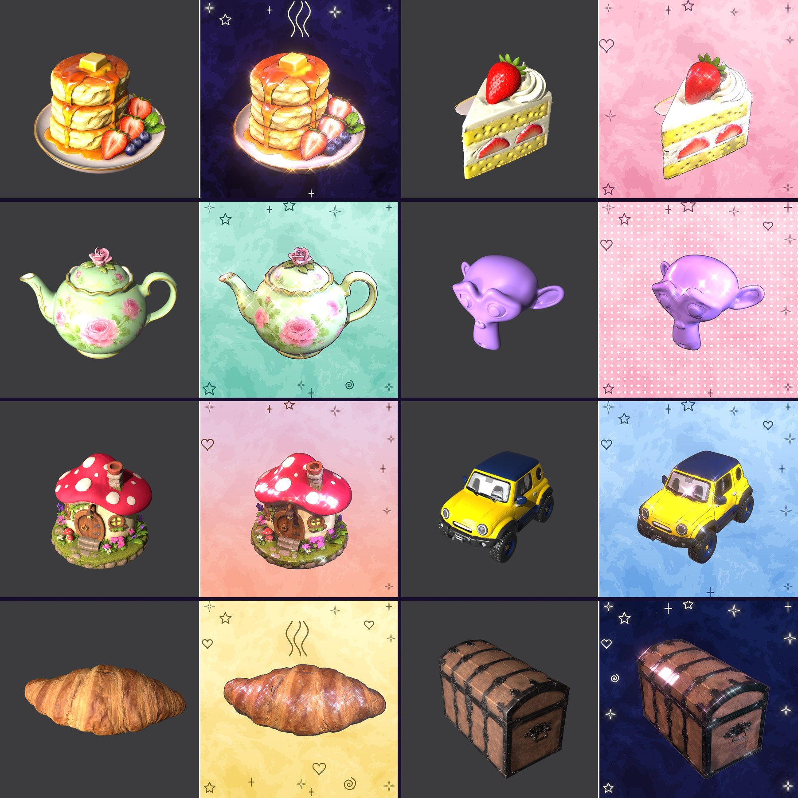

### 10 种背景

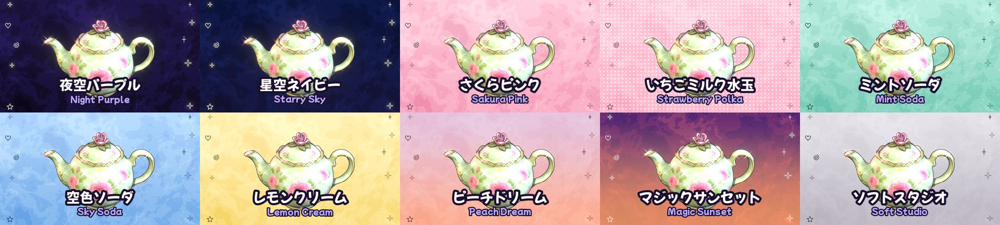

### 分层效果

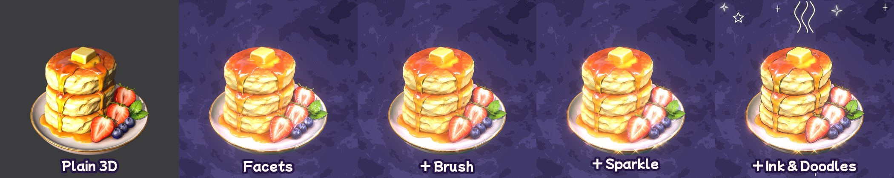

### 4 种预设

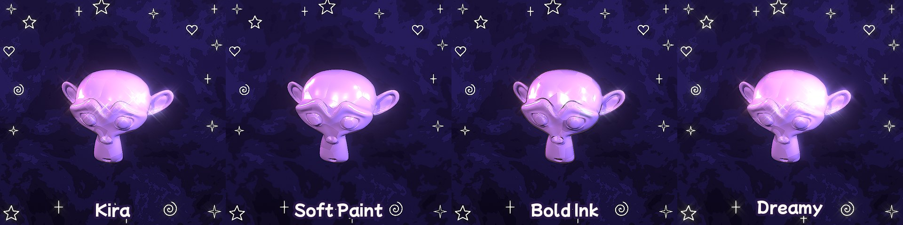

## 🧭 原理

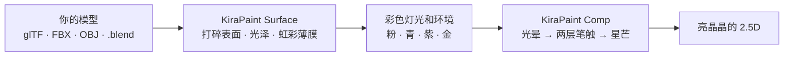

1. **KiraPaint Surface**（着色器）插在每个 Principled BSDF 前面。它按 Voronoi 单元偏转法线，把表面打碎成平整的小斜面，同时提高光泽，并加上一层薄膜虹彩。
2. 每个小斜面的朝向都不同，所以各自反射不同的**彩色灯光或环境颜色**，看起来就像碎钻。
3. **KiraPaint Comp**（合成器）把整张画面重新"涂"一遍：光晕 → 锐化 → 两层各向异性 Kuwahara → 锐化 → 混合，最后在最亮的碎面上加四芒星。

## 🚀 开始使用

### 交给 AI 代理（推荐）

对能操作电脑的 AI 代理（比如 Claude Code 或 Codex）发这样一句话：

> 按照 https://github.com/kanaworksai-hue/kirapaint 的 AGENTS.md 安装 KiraPaint，把我的模型做成亮晶晶的绘画风。

之后看着预览，用一句话就能继续调整：

- "闪光再强一点"
- "笔触再大一点"
- "彩虹色再明显一点"
- "背景换成薄荷苏打"
- "不要涂鸦"
- "加一段从写实变成画的动画，再转 60 度"

### 自己安装

**需要：** Blender 5.0 或更新版本（已在 5.1 和 5.2 上测试），渲染引擎为 EEVEE。

1. 从 [Releases](https://github.com/kanaworksai-hue/kirapaint/releases/latest) 下载 `kirapaint-x.y.z.zip`
2. Blender → 编辑 → 偏好设置 → 获取扩展 → 右上角 ▾ → **从磁盘安装…** → 选择 zip
3. 在 3D 视图按 **N** → **KiraPaint** 标签页

### 使用方法

1. 选中模型（不选的话，会作用于场景里所有网格）
2. 选风格（预设）和背景
3. 点 **Make It Kira**
4. 用 **2.5D** 滑杆在写实和绘画风之间切换，在 **Look** 里微调
5. 按 F12 渲染（笔触来自合成器，所以在渲染结果里才能看到）

<p align="center">
  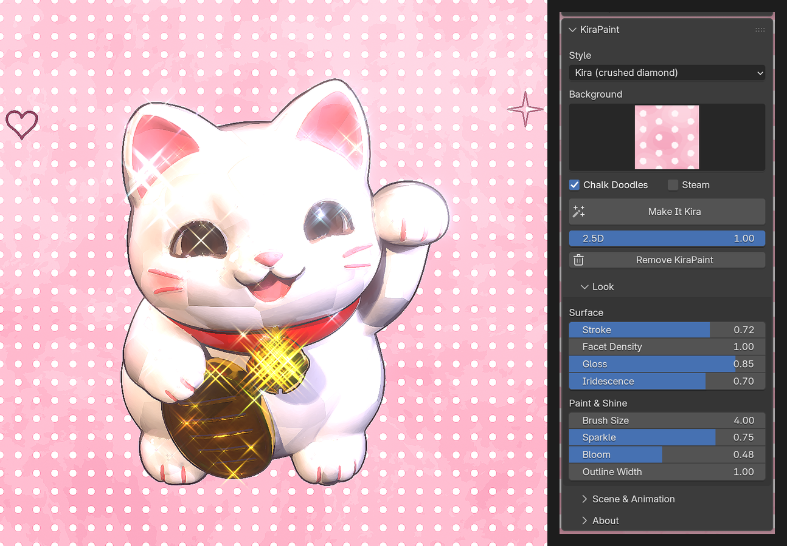
</p>

## 🎛️ 可以调什么

<details>
<summary><b>Look 面板</b></summary>

| 选项 | 作用 |
|---|---|
| 2.5D | 0 = 普通渲染，1 = KiraPaint。可以打关键帧 |
| Stroke | 表面被打碎的强度（法线扰动） |
| Facet Density | 碎面大小。1 大约是整个模型上 6 块 |
| Gloss | 碎面的光泽（把粗糙度往 0.06 拉） |
| Iridescence | 薄膜带来的粉色、青色虹彩 |
| Brush Size | 笔触大小（1080p 下的像素数，按分辨率自动换算） |
| Sparkle | 星芒强度，以及高光灯的亮度 |
| Bloom | 柔和的光晕 |
| Outline Width | 描边粗细（与模型大小成比例），0 为不描边 |
| Background | 10 种背景（点缩略图选择）或 Keep Mine（保留自己的环境） |
| Chalk Doodles / Steam | 涂鸦和热气 |

</details>

<details>
<summary><b>预设</b></summary>

| 预设 | 风格 |
|---|---|
| **Kira**（默认） | 有光泽的碎面、彩色反光、星芒，碎钻质感 |
| **Soft Paint** | 柔和的油画感，闪光较少 |
| **Bold Ink** | 粗描边，笔触利落 |
| **Dreamy** | 彩虹色和光晕都很强，梦幻感 |
</details>

<details>
<summary><b>动画</b></summary>

在 **Scene & Animation** 面板里：

- **Add Reveal：** 从当前帧开始，把 2.5D 从 0 到 1 打关键帧，画面从写实过渡到绘画风。
- **Add Turntable：** 把模型挂到中心的空物体上并旋转。灯光和相机不动，所以高光会在碎面上流动。
- **Re-aim Lights / Redraw Doodles：** 移动相机后，重新摆放灯光和涂鸦。
</details>

## ❓ 常见问题

<details>
<summary><b>能用 Cycles 吗？</b></summary>

材质部分在 Cycles 里也能用，但笔触和星芒来自合成器，效果是按 EEVEE 调的。点 **Make It Kira** 会自动切换到 EEVEE。
</details>

<details>
<summary><b>视口里看不到笔触。</b></summary>

笔触由合成器添加，在 F12 的渲染结果里才会出现。想在视口里看到，就把视口着色的"合成器"选项设为"始终"。
</details>

<details>
<summary><b>画面发白、过曝。</b></summary>

奶油色、白色的模型很容易反光过强，把 **Sparkle** 和 **Gloss** 调低一点就好。反过来，青铜、木头、南瓜这类深色模型，把 **Iridescence** 调高，彩虹色会很漂亮。
</details>

<details>
<summary><b>原来的材质会怎样？</b></summary>

不会被替换。插件在每个 Principled BSDF 前面插入一个"KiraPaint Surface"节点，并记住原来的连接和数值。点 **Remove KiraPaint** 就会恢复。没有用 Principled BSDF 的材质（比如 MochiToon 的卡通材质、只有自发光的材质）会被跳过，并在提示里列出来。
</details>

<details>
<summary><b>渲染出来的图片和视频能商用吗？</b></summary>

可以。用 KiraPaint 做出来的图片和视频都是你自己的作品。GPL 只适用于插件本身的代码，不影响你用它做出的作品（所用模型和贴图请遵守各自的许可）。
</details>

## ⭐ 点个 Star

如果你喜欢 KiraPaint，欢迎在[仓库页面](https://github.com/kanaworksai-hue/kirapaint)右上角点一下 **⭐ Star**。免费，一秒钟就好。

也欢迎在 X 上带 [@KanaWorks_AI](https://x.com/KanaWorks_AI) 和 **#KanaWorksBlender** 分享作品，或者在 [Issues](https://github.com/kanaworksai-hue/kirapaint/issues) 里告诉我们 bug 和想要的功能。

## 🧩 KanaWorks 插件

同一作者做的免费开源 Blender 插件，每一个都可以跟 AI 代理说一句话来使用。

<table>
<tr>
<td align="center" width="50%"><a href="https://github.com/kanaworksai-hue/mochitoon"></a><br><b><a href="https://github.com/kanaworksai-hue/mochitoon">MochiToon</a></b><br><sub>把 3D 变成可爱的漫画风：彩色阴影、爱心和星星网点、描边</sub></td>
<td align="center" width="50%"><a href="https://github.com/kanaworksai-hue/kirapaint">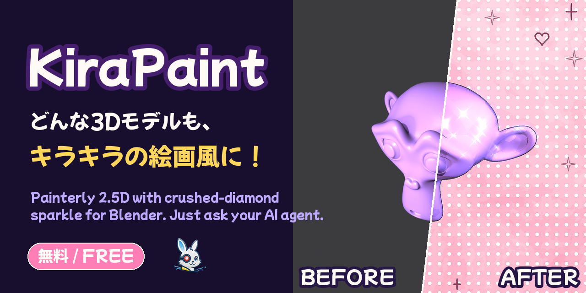</a><br><b>KiraPaint</b>（本页）<br><sub>把 3D 变成亮晶晶的绘画风 2.5D：碎钻光泽、笔触、星芒</sub></td>
</tr>
</table>

## 🛠️ 开发

```bash
# 冒烟测试
blender -b --factory-startup --python tests/test_ops.py

# 任意模型的应用前 / 应用后
blender -b --factory-startup --python tests/render_demo.py -- model.glb tests/out/demo KIRA 1080 1350

# 在 dist/ 里生成发布用的 zip
blender --factory-startup --command extension build --source-dir kirapaint --output-dir dist
```

```
kirapaint/
  nodes.py     "KiraPaint Surface" 着色器节点组和 "KiraPaint Comp" 合成器节点组
  core.py      材质的插入与还原、描边、灯光、环境、合成器、动画
  doodles.py   粉笔涂鸦（Grease Pencil）
  api.py       make_kira()：给代理和脚本用的一键入口
  ops.py, ui.py  设置、操作和面板
  presets.py   4 种预设
agent/kirapaint_agent.py  给 AI 代理用的命令行
```

## 📄 许可和致谢

- **本插件：** Copyright © 2026 东京AI映像合同会社。以 [GPL-3.0-or-later](LICENSE) 发布。
- **品牌：** KanaWorks_AI 的名称、logo 和 Kana 形象归东京AI映像合同会社所有，**不在** GPL 授权范围内。详见 [docs/brand](docs/brand/README.md)。
- **示例模型：** 作者自己的模型、CC0 模型，以及 Blender 自带的 Suzanne。
- **原理来源：** 用 Kuwahara 滤镜和噪波扰动法线做绘画风，是 Blender 社区里广泛分享的技法。
- **Blender** 是 Blender Foundation 的商标。本项目是独立项目，与 Blender Foundation 没有合作关系，也未获其认可。

<br>

<div align="center">

<a href="https://x.com/KanaWorks_AI"></a>

<p><b>Made with ♥ by <a href="https://x.com/KanaWorks_AI">KanaWorks_AI</a></b></p>

<p><sub>如果 KiraPaint 帮到了你，你的 ⭐ 就是下次更新的动力。更多项目：<a href="https://github.com/kanaworksai-hue">github.com/kanaworksai-hue</a></sub></p>

</div>
